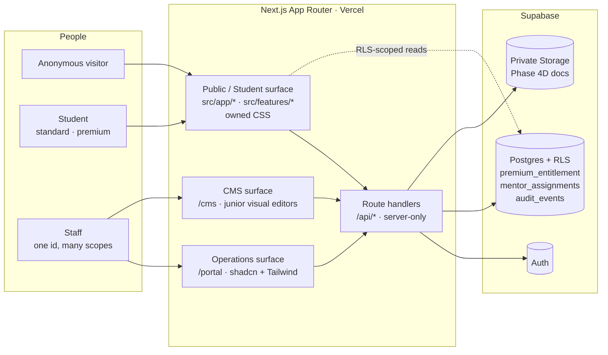
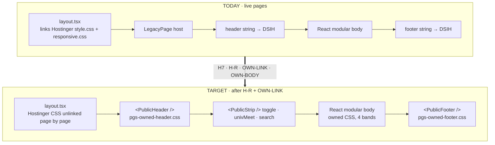
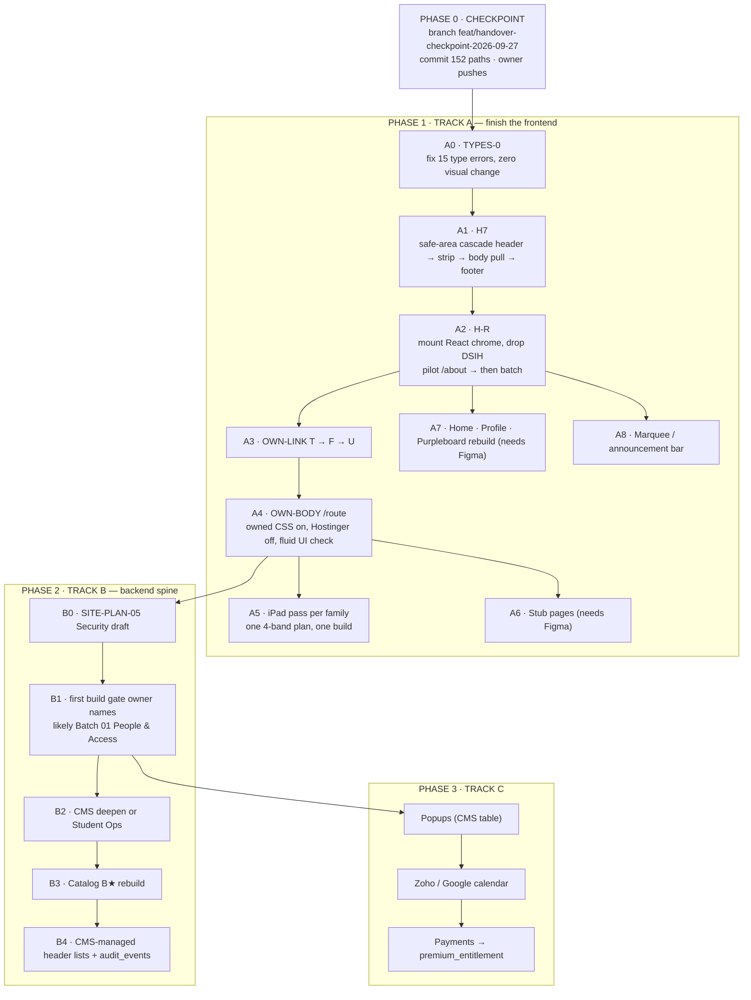
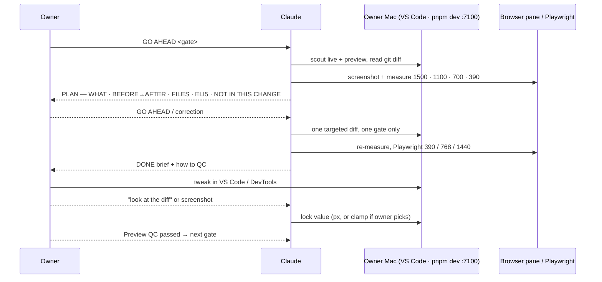

# PGS V3 — Architect plan (Claude Code handover, 2026-09-27)

Living plan for the move from Cursor to Claude Code. Companion to `.cursor/skills/pgs-master-workflow/SKILL.md`, `docs/HEADER-CHROME-PHASE.md`, `docs/SITE-BACKEND-PLAN.md`. Same lock: **propose → owner `GO AHEAD <gate>` → one gate → owner Preview QC → stop.**

Rendered copy with the same diagrams: Claude artifact "PGS V3 Architect Plan".

---

## 1 · Stack (locked)

| Layer | What | Rule |
|---|---|---|
| Runtime | Next.js App Router · React · strict TypeScript · pnpm | Routes `src/app`, bodies `src/features/<family>` |
| Data / auth | Supabase Postgres · Auth · Storage · RLS · RPCs | Schema only via `supabase/migrations`; one truth per domain |
| Public / student UI | Owned CSS per family · four bands `>1366 · 801–1366 · 601–800 · ≤600` | Hostinger `style.css` = reference only |
| Ops / CMS UI | shadcn + Tailwind | Junior CMS editors untouched unless reopened by name |
| Quality gates | Vitest · Playwright (390 / 768 / 1440) · `test:rls` · `test:security` | Skipped ≠ passed |
| Hosting | Vercel · GitHub `project-mtfbwu/pgs-v3` | Feature branches, never direct to `main` |
| Steal like an artist | dnd-kit · Uppy · Monday/Linear board patterns · Reference Bank IDs | Read, adapt onto V3 contracts, never dump their auth |

## 2 · System map

## 3 · Public page model — today vs target

## 4 · Where we are (measured 2026-09-27 on the owner Mac)

- Git: `main` = `origin/main` = `792ee9a`; 152 uncommitted paths local only; no secrets in the pile.
- Typecheck: **15 errors in 6 files** (`purple-events/upcoming/content.ts`, `shell/public-footer.tsx`, `uni-tieup-initiatives.tsx`, `cvready-program-video.tsx`, `cvready-program-discover.tsx`, `face-fixtures.test.ts`).
- Live cutover done: About, Explore, Finance, Scholarship, Premium Home, USMLE/PLAB/AMC, USMLE Rotation, CV Ready, Uni Tie-up, Feed, Track Progress, Upload Docs, Error 404. Desktop + mobile passed; **iPad deferred** almost everywhere.
- Home, Profile, Purpleboard: owner wants a from-scratch rebuild (needs Figma).
- Chrome: desktop + iPad header locked (decision 36); owned split P1–P15 lab only; search restyle reverted; **H7 and H-R open**.

## 5 · Roadmap — one gate at a time

iPad family order for A5: About → Explore → Finance → Scholarship → Premium Home → Medical → CV Ready → Uni Tie-up → Feed → Track Progress.

## 6 · The loop for every gate

## 7 · Owner decisions log

| # | Topic | Decision | Date |
|---|---|---|---|
| 1 | Checkpoint branch | `feat/handover-checkpoint-2026-09-27` | 2026-09-27 |
| 2 | A0 (type errors) before H7 | Yes | 2026-09-27 |
| 3 | This plan in repo | Yes, `docs/CLAUDE-ARCHITECT-PLAN.md` | 2026-09-27 |
| 4 | Home / Profile / Purpleboard after H-R | Proposed, awaiting owner | — |
