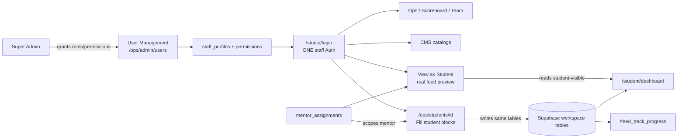
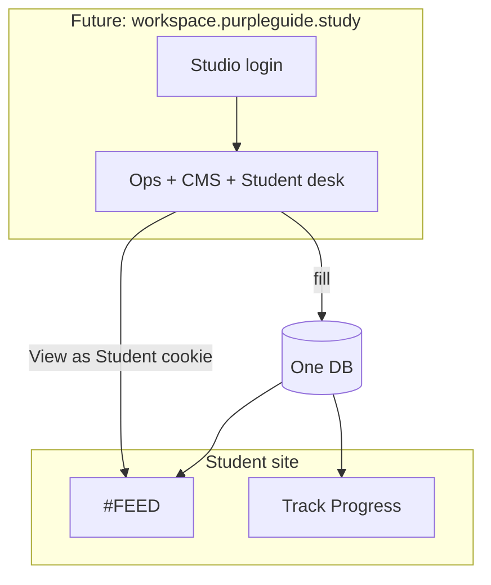
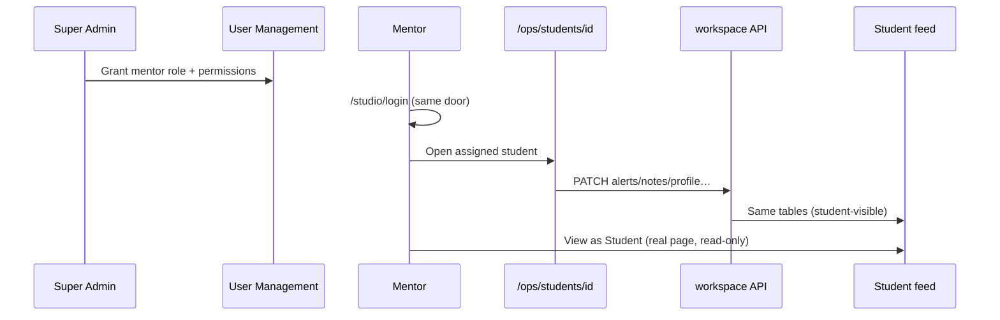

# FEED + WORKSPACE living plan

**Status:** PLAN — no product code until owner `GO AHEAD` per gate.  
**Update this file** after every gate (Implementation log).  
**Opus advisory:** 2026-10-07 · bank RB-01 / RB-02 / RB-04 / RB-05 / RB-06 / RB-07 / RB-08.

Related: [`STUDENT-FEED-MODULAR.md`](./STUDENT-FEED-MODULAR.md) · [`FEED-TRACK-PROGRESS-MODULAR.md`](./FEED-TRACK-PROGRESS-MODULAR.md) · skill `pgs-student-ops` · [`OPS-USER-MANAGEMENT-LOCK.md`](./OPS-USER-MANAGEMENT-LOCK.md) · [`OPS-STUDIO-LOGIN-LOCK.md`](./OPS-STUDIO-LOGIN-LOCK.md).

**Visual QC pack:** [`/preview/feed-workspace-qc/`](../public/preview/feed-workspace-qc/) (open images in browser).

---

## 1. Tech stack (locked — build on this)

| Layer | Locked choice | Where in PGS |
|---|---|---|
| App | Next.js App Router · React · TypeScript · pnpm | `src/app`, `src/features` |
| Host | Vercel (student site + later `workspace.` host) | — |
| Auth | **One** Supabase Auth (same staff identity) | `/studio/login` · student `/login` separate surface |
| DB | Supabase Postgres + RLS + RPCs | `supabase/migrations` |
| Staff UI | shadcn/ui + Lucide · owned Ops CSS | `/ops/*` · `/studio/*` |
| Student UI | Owner Figma / modular feed CSS (not restyle from bank) | `/student/dashboard`, `/feed_track_progress` |
| Tables (ops) | TanStack Table | Registry |
| Forms | React Hook Form + Zod | Staff forms |
| Charts | shadcn Chart → Recharts | Scoreboard only when data real |
| Kanban | dnd-kit (Loopboard later) | RB-06 |
| Realtime | Supabase Realtime **only** if owner asks for live comments | RB-04/05 |
| Tests | Vitest + Playwright | `src/**/*.test.ts`, `tests/e2e` |

**Google analogy (owner lock):** One Google account → Gmail + Docs + Drive.  
One **Studio login** → User Management + Ops + CMS + Student desk + View as Student.  
SA grants roles/permissions in User Management (`/ops/admin/users`) → mentor/admin opens the same `/studio/login` → only sees what their permissions + `mentor_assignments` allow.

```text
AUTH USER (Supabase)
  → staff_profiles
  → roles / permissions (SA grants in Studio User Management)
  → surface access (Ops / CMS / Student desk)
  → record scope (mentor = assigned students only)
```

---

## 2. References to read before building

### Product / locks (owner authority)
| Doc / skill | Why |
|---|---|
| This file | Living gates + fill map |
| [`STUDENT-FEED-MODULAR.md`](./STUDENT-FEED-MODULAR.md) | Feed blocks + preview labs |
| [`FEED-TRACK-PROGRESS-MODULAR.md`](./FEED-TRACK-PROGRESS-MODULAR.md) | Track Progress blocks |
| Skill `pgs-student-ops` | Student Ops tabs / comments contract |
| [`OPS-STUDIO-LOGIN-LOCK.md`](./OPS-STUDIO-LOGIN-LOCK.md) | Staff door |
| [`OPS-USER-MANAGEMENT-LOCK.md`](./OPS-USER-MANAGEMENT-LOCK.md) | SA grants permissions (already built) |
| [`OPS-STUDENT-REGISTRY-STU1.md`](./OPS-STUDENT-REGISTRY-STU1.md) | `/ops/students` |
| [`OPS-STUDENT-DETAIL-STU2.md`](./OPS-STUDENT-DETAIL-STU2.md) | `/ops/students/[id]` |

### Reference Bank (patterns only — never copy code dumps)
| Bank ID | Use for |
|---|---|
| **RB-01** Twenty / HubSpot CRM | Student registry, drill-down, ownership |
| **RB-02** Supabase Auth/RLS | Role vs permission, least privilege, grant/revoke |
| **RB-04** Linear Inbox / Chatwoot | Notifications to student after mentor fill |
| **RB-05** Chatwoot | Comments thread (student ↔ mentor) |
| **RB-06** Plane | Journey Map / Loopboard |
| **RB-07** Plane | Review Queue |
| **RB-08** Phase 4D (not new storage) | Documents |

### Code to open first
| Path | Role |
|---|---|
| `src/lib/staff-auth.ts` | Permissions set |
| `src/lib/staff-preview.ts` + `staff-preview-server.ts` | View as Student |
| `src/app/api/staff/preview/route.ts` | Start/exit preview |
| `src/app/api/staff/students/[studentId]/workspace/[resource]/route.ts` | Mentor fill API |
| `src/lib/premium-workspace.ts` | Shared loader |
| `src/features/student-feed/` | Feed UI + loaders |
| `src/features/feed-track-progress/` | Track Progress UI |

---

## 3. Visual QC gallery (see + click)

Open locally (dev on `:7000`):

| # | What | File / URL |
|---|---|---|
| 0a | Architecture board (one login → many surfaces) | [`00-architecture-board.jpg`](../public/preview/feed-workspace-qc/00-architecture-board.jpg) |
| 0b | Fill-map board (DYNAMIC / MENTOR columns) | [`00-fill-map-board.jpg`](../public/preview/feed-workspace-qc/00-fill-map-board.jpg) |
| 1 | Studio login (staff door) | [`01-studio-login.png`](../public/preview/feed-workspace-qc/01-studio-login.png) · live [`/studio/login`](http://localhost:7000/studio/login) |
| 2 | Student #FEED Premium (what student sees) | [`02-student-feed-premium.png`](../public/preview/feed-workspace-qc/02-student-feed-premium.png) · live [`/preview/student-feed-premium`](http://localhost:7000/preview/student-feed-premium) |
| 3 | Track Progress Premium | [`03-track-progress-premium.png`](../public/preview/feed-workspace-qc/03-track-progress-premium.png) · live [`/preview/feed-track-progress-premium`](http://localhost:7000/preview/feed-track-progress-premium) |
| 4 | Ops scoreboard (mentor role) | [`04-ops-scoreboard-mentor.png`](../public/preview/feed-workspace-qc/04-ops-scoreboard-mentor.png) |
| 5 | Staff desk (after login) | live [`/ops/students`](http://localhost:7000/ops/students) — needs Studio session |

---

## 4. Mermaid — identity & surfaces (Google-style)







---

## Owner locks (2026-10-07)

| # | Lock |
|---|---|
| L1 | Student **#FEED** (`/student/dashboard`) and **Track Progress** (`/feed_track_progress`) = what the student sees. Mentor/Admin fill from Studio/Ops. |
| L2 | One mentor → many students via `mentor_assignments`. **One student truth.** No second student DB. |
| L3 | Staff host later: **`workspace.purpleguide.study`**, path prefix `/workspace/*`. **Not shipped** — today `/ops/*` → `/admin/*`. **Owner 2026-10-08:** QC on **current domain** first; subdomain is a later port (WS-HOST), not a blocker for desk/chrome gates. |
| L4 | Student `/login` = students only. Staff doors = `/studio/login` **and** `/workspace/login` (WS-LOGIN-1 · same Auth + UM grants; students rejected). Legacy `/mentor` / `/cms` = 404. |
| L5 | Mentor **previews the student's real feed with real data** (FB Ads–style preview of the live page). Not a mock. Reuse View as Student. **LOCKED 2026-10-07:** mentors **can** View as Student for **assigned students only** (Admin/SA keep org scope). |
| L6 | Audit columns: DYNAMIC · MENTOR ASSIGNS · MENTOR FILLS · MENTOR FILLS + ADMIN/SA. Comments = separate tab. Track Progress + Journey Map (Loopboard). |

---

## Product picture (Ads Manager + real preview)

```text
STAFF (Ads Manager desk)                         STUDENT (live "ad" view)
/ops/students          → find student            /student/dashboard   (#FEED)
/ops/students/[id]     → fill blocks  ──same──▶  /feed_track_progress
                         tables
[View as Student] ── cookie preview ──────────▶  REAL routes + REAL data
                                                 banner · read-only · no password
```

- **Fill** = staff write APIs on shared workspace tables.  
- **Preview** = the **live** student page for that student (student-visible rows only).  
- **No** fake feed inside Ops.

---

## Surfaces & future domain

| Surface | Today | Future |
|---|---|---|
| Student feed | `/student/dashboard` | unchanged (student host) |
| Track Progress | `/feed_track_progress` | unchanged |
| Staff registry | `/ops/students` | `/workspace/students` (**FEED-HOST**) |
| Staff student desk | `/ops/students/[id]` | `/workspace/students/[id]` |
| Staff login | `/studio/login` · `/workspace/login` | same doors on workspace host later |
| Preview API | `POST /api/staff/preview` | unchanged |

**Host note:** preview cookie is host-only. When staff move to `workspace.` and students stay on main host, need a signed handoff — **FEED-HOST**, not now.

---

## View as Student (real-data preview)

### What exists today

| Piece | Path | Behavior |
|---|---|---|
| Cookie | `src/lib/staff-preview.ts` | HMAC token · `pgs_staff_preview` · ≤30 min · httpOnly |
| Who can start | `src/lib/staff-preview-server.ts` `canUseStaffPreview` | **DONE FEED-VAS:** Admin/SA any student · Mentor **assigned only** |
| Start/exit | `src/app/api/staff/preview/route.ts` | Cookie + audit · lands `/student/dashboard` · exit → `/ops` |
| Mutations | `src/proxy.ts` | Non-GET `/api/*` → 403 while cookie set |
| Banner | `src/components/staff-preview-banner.tsx` | On feed dashboard; **missing on Track Progress** |
| Entry | Registry row “View as Student” | **Not on** `/ops/students/[id]` header |
| Scope check | Start route | Student exists only — **no `mentor_assignments` check** |

### ADOPT
Signed cookie · actor rebind · audit start/end/deny · proxy read-only · new-tab open · `studentVisibleOnly` in `loadPremiumWorkspace`.

### ADAPT (FEED-VAS — **shipped 2026-10-07**)
1. Mentors preview **only assigned** students — checked on **start** (`canPreviewStudentTarget`) and **every read** (`getStaffPreviewContext` / `getActiveStudentPreviewTargetId`).  
2. Capability via role (mentor / admin / SA) or `student_workspace.read` / `read_all` (no new permission seed this gate).  
3. Feed loaders use `previewAwareSupabaseClient`.  
4. Banner on `/feed_track_progress` (standard + Premium).  
5. Button on `/ops/students/[id]` header + registry (row-scoped for mentors).  
6. View as Mentor remains Admin/SA only (`canStartMentorPreview`).

### MUST NOT
Mock feed in Ops · mentor preview of unassigned students · leak `staff_only` · writes while previewing · student password / session takeover · parent-domain cookie without approval.

---

## Fill map — #FEED (Premium Family B)

| Block | Audit | Table | Staff write | Student reader | Status |
|---|---|---|---|---|---|
| Identity | DYNAMIC | `profiles` | student profile APIs | premium identity | **WIRED** |
| Quick Dashboard | MENTOR FILLS | `premium_workspace_profiles` | `PATCH …/workspace/profile` | `load-feed-quick-dashboard.ts` | **WIRED** |
| Notes | MENTOR FILLS | `notes_html` | `PATCH …/workspace/profile` | `load-feed-notes.ts` | **WIRED (WS-FILL-2)** |
| Top Picks | MENTOR ASSIGNS | `student_feed_top_picks` + `courses` | Desk top-picks API | `load-feed-top-picks.ts` | **LOCKED (WS-FILL-3)** |
| Where You Stand | MENTOR FILLS | `premium_workspace_profiles` + finalized selections + CMS uni media | `…/profile` + `…/universities` | `load-feed-where-you-stand.ts` | **WIRED (WS-FILL-4 / 4B)** |
| Comments | MENTOR+ADMIN | `workspace_comments` | `…/comments` | fixture-B6 | **FIXTURE** |
| Upcoming Events | DYNAMIC | `events` | CMS | `list-feed-upcoming-events.ts` | **WIRED** |

Family A (anon/standard) = locked fixtures; mentor fill is Premium workspace.

## Fill map — Track Progress (Premium)

| Block | Audit | Table | Staff write | Status |
|---|---|---|---|---|
| Important Alerts | MENTOR FILLS | `student_alerts` | `…/alerts` | **WIRED** |
| Draft Meter | MENTOR FILLS | `student_document_requirements` | Desk Documents | **WIRED (FTP-B2)** |
| Review Queue | MENTOR FILLS | `review_queue_items` | `…/reviews` | **WIRED (FTP-B3)** |
| Counselor Notes | MENTOR+ADMIN | `counselor_notes` | Desk Notes | **WIRED (FTP-B4)** |
| Journey Map | MENTOR+ADMIN | `student_board_columns` / `student_tasks` | `…/tasks` | **FIXTURE** |
| Resource Drop / Tips | MENTOR SHARED | Mentor Assigns (`/workspace/mentor-assigns`) | **FTP-B7a fixture** · DB B7b · student B7c |
| Universities | MENTOR ASSIGNS | `student_university_selections` | `…/universities` | **GAP** (no student block mapped) |
| Documents | Phase 4D | requirements + documents | `…/requirements` + premium docs APIs | separate page |

---

## Router / API / DB (verify before implement)

### Routes
| URL | File |
|---|---|
| `/student/dashboard` | `src/app/student/dashboard/page.tsx` |
| `/feed_track_progress` | `src/app/feed_track_progress/page.tsx` |
| `/ops/students` | `src/app/admin/students/page.tsx` |
| `/ops/students/[id]` | `src/app/admin/students/[studentId]/page.tsx` |
| Preview labs | `/preview/student-feed-premium`, `/preview/feed-track-progress-premium` |

### APIs
| Method + path | Role |
|---|---|
| `POST /api/staff/preview` | Start/exit View as Student |
| `POST/PATCH/DELETE /api/staff/students/[id]/workspace/[resource]` | `profile` · `comments` · `tasks` · `alerts` · `reviews` · `notes` · `requirements` · `universities` · `documents` |
| `POST /api/staff/assignments` | Mentor assign/end |
| `/api/premium/comments` | Student comment write |
| `/api/premium/documents/*` | Phase 4D |

**API gap:** profile PATCH can blank unsent fields if body is partial — fix before Notes writer (**FEED-PROFILE-PATCH**).

### Tables (one truth)
`profiles` · `premium_entitlements` · `mentor_assignments` · `staff_profiles` · `premium_workspace_profiles` · `student_alerts` · `review_queue_items` · `counselor_notes` · `workspace_comments` · `student_board_columns` · `student_tasks` · `student_document_requirements` · `student_documents` · `student_university_selections` · `notifications` · `audit_events`

---

## Implementation gates

| Gate | Scope | Bank |
|---|---|---|
| **FEED-0** | This living MD | — |
| **FEED-MAP** | Owner confirms audit column per block; resolve “confirm” cells | RB-01 |
| **FEED-VAS** | Mentor preview + assignment scope + detail button + Track Progress banner + preview-aware loaders | RB-02 |
| **FEED-NOTES** | Migration `notes_html` + safe writer + staff editor | **DONE via WS-FILL-2** |
| **FEED-PROFILE-PATCH** | Partial profile PATCH | — |
| **FEED-WYS / TP-DRAFT** | Where You Stand + Draft Meter live | — |
| **TP-REVIEW** | Review Queue live | RB-07 |
| **TP-NOTES** | Counselor Notes live | RB-05 |
| **TP-LOOP** | Journey Map live (read-only student first) | RB-06 |
| **FEED-COMMENTS** | Comments live + separate tab | RB-05 / RB-04 |
| **FEED-PICKS** | Top Picks (owner D4) | RB-09 |
| **SO-ALIGN** | Ops student tabs match fill locations | RB-01 |
| **FEED-HOST** | `/workspace/*` + `workspace.purpleguide.study` + preview handoff | RB-02 · **DEFERRED** |

---

## NOT IN SCOPE / DEFERRED
- Workspace host cutover (**FEED-HOST**)  
- Student-created Loopboard items  
- Family A redesign  
- Side-by-side edit+preview pane  
- Realtime comments (unless owner asks)  
- Guardian feed views  

---

## Owner decisions (open)

| ID | Question | Recommended |
|---|---|---|
| **D1** | Mentor preview scope? | **LOCKED:** Assigned students only |
| **D2** | Preview button where? | **LOCKED:** Registry **and** `/ops/students/[id]` header |
| **D3** | Preview Standard (non-Premium) students? | Yes (Family A page); fill still Premium-only |
| **D4** | Top Picks source? | **LOCKED:** mentor-assign per student (courses) · WS-FILL-3 |
| **D5** | University shortlist on which student page? | TBD |
| **D6** | Notes = plain text or rich later? | Plain text first |
| **D7** | Who posts on student comment thread? | Mentor + Admin/SA; private notes stay staff-only |
| **D8** | Preview TTL? | Keep 30 min |

---

## Design / QC refs

| Ref | Where |
|---|---|
| Owner audit (feed + track columns) | Owner screenshot (chat) |
| Generated fill-map board | Cursor assets `feed-mentor-fill-design-ref.jpg` |
| Live Premium feed lab | `http://localhost:7000/preview/student-feed-premium` |
| Live Track Progress lab | `http://localhost:7000/preview/feed-track-progress-premium` |
| Staff desk | `http://localhost:7000/studio/login` → `/ops/students` |

---

## Implementation log

| Date | Gate | GO AHEAD | Changed | Tests | Security | Owner QC | Remaining |
|---|---|---|---|---|---|---|---|
| 2026-10-07 | **FEED-0** | owner: living MD | `docs/FEED-WORKSPACE-PLAN.md` created | — | — | pending read | FEED-MAP / FEED-VAS decisions |
| 2026-10-07 | **FEED-0b** | owner: tech stack + visuals | Tech stack · refs · Mermaid · QC gallery under `public/preview/feed-workspace-qc/` · Google-login analogy locked | — | — | open QC folder + labs | Confirm D1–D2 then FEED-VAS or FEED-MAP |
| 2026-10-07 | **FEED-VAS** | `GO AHEAD FEED-VAS` | Mentor assigned-scope preview · start+read checks · detail + registry buttons · Track Progress banner · `previewAwareSupabaseClient` on feed/alerts loaders · View as Mentor stays Admin/SA | `staff-preview-vas.test.ts` + related (8 pass) | Assignment revoke ends preview; out_of_scope audited | Owner: mentor login → assigned student → View as Student → feed + Track Progress | FEED-MAP / FEED-NOTES |
| 2026-10-07 | **WS-CHROME propose** | awaiting GO AHEAD | ChatGPT mocks → `public/preview/feed-workspace-qc/chatgpt-mocks/`. Chrome-first build order. Conflict: Ops C1–C3 LOCKED (blue + old IA) vs ChatGPT purple + Students/Comments/Loopboard IA. | — | — | pick C-BRAND · C-NAV · C-SHELL | WS-CHROME-1 |
| 2026-10-07 | **WS-CHROME-1** | `GO AHEAD` + Studio palette | Shell brand → Studio `#6b3fa0` · primary nav Students / Overall Comments / Loopboard stubs · reuse AdminShell · [`WS-CHROME-LOCK.md`](./WS-CHROME-LOCK.md) | — | chrome only | Owner: `/ops` purple + stub links | WS-REG or WS-DESK next |
| 2026-10-08 | **WS-DESK** | `GO AHEAD WS-DESK` · make live | Desk header (badge · meta · VAS) · 5 tabs · split workspace panels · [`WS-DESK-LOCK.md`](./WS-DESK-LOCK.md) | — | reuse CRM + workspace APIs | Owner: `/ops/students/[id]` | WS-REG or WS-FILL-* |
| 2026-10-08 | **WS-LOGIN-1** | plan execute · redirect fix | Staff-only `/workspace/login` → **`/workspace` empty** (not Ops) · [`WS-LOGIN-LOCK.md`](./WS-LOGIN-LOCK.md) | auth + login route tests | UM grants unchanged; students rejected | Owner: empty shell QC | Workspace chrome next |
| 2026-10-08 | **WS-LOGIN-UI** | `GO AHEAD WS-LOGIN-UI` | Centered mock login (no Ops feature rail) · [`WS-LOGIN-UI-LOCK.md`](./WS-LOGIN-UI-LOCK.md) | — | auth unchanged | Owner: `/workspace/login` visual | **WS-HOME-1** next |
| 2026-10-08 | **WS-HOME-1** | QC passed → next | Workspace header from ChatGPT mock · logout → workspace login · [`WS-HOME-LOCK.md`](./WS-HOME-LOCK.md) | logout workspace surface | — | Owner: `/workspace` header | Sidebar / footer next |
| 2026-10-08 | **WS-SIDEBAR-1** | `ok go ahead` | Dark rail nav + Students/Desk stubs · [`WS-SIDEBAR-LOCK.md`](./WS-SIDEBAR-LOCK.md) | — | stubs only | Owner: `/workspace` sidebar | Footer or WS-REG next |
| 2026-10-08 | **WS-FOOTER-1** | sort avatar + go ahead | Footer rail · avatar circular clip fix · [`WS-FOOTER-LOCK.md`](./WS-FOOTER-LOCK.md) | — | chrome | Owner: `/workspace` | Dashboard or WS-REG next |
| 2026-10-08 | **WS-REG** | `GO AHEAD` student registry | Workspace list + tabs + Open Desk · same STU1 RPC · [`WS-REG-LOCK.md`](./WS-REG-LOCK.md) | — | mentor scope unchanged | Owner: `/workspace/students` | Per-student desk body next |
| 2026-10-08 | **WS-SIDEBAR-2** | upgrade sidebar + next step | Light tree rail · brand in rail · Overall Comments + Loopboard stubs · [`WS-SIDEBAR-LOCK.md`](./WS-SIDEBAR-LOCK.md) | — | chrome | Owner: `/workspace` light nav | Desk live |
| 2026-10-08 | **WS-DESK-WS** | with sidebar upgrade | `/workspace/students/[id]` five tabs · same Ops desk truth · [`WS-DESK-WS-LOCK.md`](./WS-DESK-WS-LOCK.md) | — | reuse CRM + workspace APIs | Owner: Open Desk from Workspace registry | WS-FILL-* / Overall Comments |
| 2026-10-08 | **WS-CHROME-SHELL** | owner: lock chrome · move on | Header + Sidebar-2 + Footer + shell **LOCKED** Gmail-stable · [`WS-CHROME-SHELL-LOCK.md`](./WS-CHROME-SHELL-LOCK.md) | — | chrome freeze | Owner confirmed | **Next body gate** (propose below) |
| 2026-10-08 | **WS-DASH** | `GO AHEAD WS-DASH` | Dashboard body · real My/Premium counts · deferred review/events/activity/tasks · [`WS-DASH-LOCK.md`](./WS-DASH-LOCK.md) | — | scoreboard reuse | Owner: `/workspace` | WS-FILL-* / WS-COMMENTS |
| 2026-10-08 | **WS-REG QC** | owner: registry QC passed | Registry **LOCKED** · [`WS-REG-LOCK.md`](./WS-REG-LOCK.md) | — | — | Owner passed | OG Dashboard polish → WS-FILL-1 |
| 2026-10-08 | **WS-DASH-2** | owner: OG dash UI messed up | Mock screen 2 layout · drop shortcut row · quiet empties · [`WS-DASH-LOCK.md`](./WS-DASH-LOCK.md) | — | body only | Owner: `/workspace` | **WS-FILL-1** Student Dashboard Data |
| 2026-10-08 | **WS-DASH-3** | owner: actual OG dashboard reference | Sort UI to ref · icons · date chrome · View all · solid purple nav active · no fake rows · [`WS-DASH-LOCK.md`](./WS-DASH-LOCK.md) | — | body + sidebar active | Owner: `/workspace` | **WS-FILL-1** |
| 2026-10-08 | **WS-FILL-1** | `GO AHEAD WS-FILL-1` | Desk Dashboard Data · Preview + Quick Dashboard live · Notes/Picks/Stand deferred · [`WS-FILL-1-LOCK.md`](./WS-FILL-1-LOCK.md) | — | reuse profile PATCH | Owner: Open Desk → Dashboard Data | WS-FILL-2 Where You Stand / Notes |
| 2026-10-08 | **WS-FILL-1 QC** | owner: lock it · next Mentor Notes | FILL-1 **LOCKED** · [`WS-FILL-1-LOCK.md`](./WS-FILL-1-LOCK.md) | — | — | Owner passed | **WS-FILL-2** Mentor Notes → student #FEED |
| 2026-10-08 | **WS-FILL-2** | `GO AHEAD WS-FILL-2` | `notes_html` migration · sanitize PATCH · Desk Mentor Notes editor → #FEED · [`WS-FILL-2-LOCK.md`](./WS-FILL-2-LOCK.md) | sanitize unit exists | RLS staff update + student select | Owner: Save Notes → View as Student | Top Picks / Where You Stand |
| | | | | | | | |

---

## Top-down build order (owner method)

```text
WS-CHROME-SHELL  Header + Sidebar-2 + Footer + shell  ✓ LOCKED (Gmail-stable)
WS-REG           Student Registry                     ✓ LIVE
WS-DESK / WS-DESK-WS  Desk tabs (Ops + Workspace)     ✓ LIVE
WS-REG           Student Registry                     ✓ QC PASSED LOCKED
WS-DASH / DASH-2 Mentor OG dashboard body             ✓ LIVE (await QC)
WS-FILL-1        Student Desk → Dashboard Data UI     ✓ QC PASSED LOCKED
WS-FILL-2        Mentor Notes → student #FEED         ✓ LIVE (await QC)
WS-FILL-3        Top Picks mentor-assign              ← DONE (apply migration)
WS-FILL-4        Where You Stand                      ← WIRED (QC → LOCK)
WS-FILL-5        Comments                             ← NEXT

WS-COMMENTS      Per-student comments (LOCKED) + Overall Comments inbox
WS-OC-1          Overall Comments fixture table       ← amended (table only)
WS-OC-2          Live scoped table (`workspace_comments`) ← LOCKED
WS-OC-3          Reply in Overall Comments            ← REJECTED (owner: Desk only)
FTP-B7a          Mentor Assigns Tips/Resource tabs    ← WIRED
FTP-B7b          Shared tips/resources DB + Save      ← WIRED (apply migration)
FTP-B7c          Student Track Progress live from Mentor Assigns
WS-REVIEW        Review & Notes / alerts / queue
WS-DOCS          Documents tab
WS-LOOP          Loopboard (global kanban)
WS-HOST          workspace.purpleguide.study later
```

**Rule:** Before every gate → overview · files · ELI5 · APIs · visual · wait `GO AHEAD` → build → owner QC → next.

### ChatGPT UI refs (owner 2026-10-07)

| File | Screens |
|---|---|
| [`chatgpt-mocks/shell-registry-desk.jpg`](../public/preview/feed-workspace-qc/chatgpt-mocks/shell-registry-desk.jpg) | Login · Dashboard · Registry · Desk Dashboard Data · Desk Comments |
| [`chatgpt-mocks/overall-comments.jpg`](../public/preview/feed-workspace-qc/chatgpt-mocks/overall-comments.jpg) | Overall Comments inbox + thread panel |
| [`chatgpt-mocks/loopboard.jpg`](../public/preview/feed-workspace-qc/chatgpt-mocks/loopboard.jpg) | Global Loopboard kanban |

### WS-CHROME-1 decisions required

| ID | Question | Options |
|---|---|---|
| **C-BRAND** | Workspace chrome brand color? | (a) Keep locked Ops **screenshot blue** (b) Switch shell to **purple** like ChatGPT mocks (Studio login stays purple either way) |
| **C-NAV** | Sidebar IA? | (a) **Keep** locked Ops nav + **add** Students / Overall Comments / Loopboard (b) **Replace** with ChatGPT nav and park old groups under More |
| **C-SHELL** | Reuse `AdminShell`? | **Recommended:** yes — extend one shell, do not fork |
