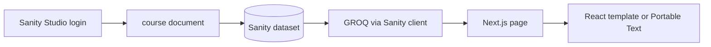
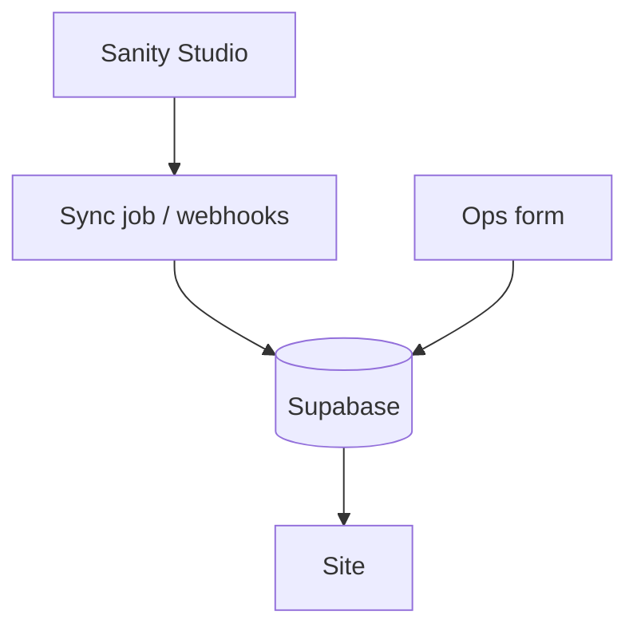

# Sanity CMS — analysis only (NOT installed)

**Status:** Documentation / product study only.  
**Hard rule:** Do **not** install Sanity. Do **not** change Ops CMS, Supabase, APIs, or COURSE2 work based on this file.

Illustrative screenshots (generated for teaching, not product UI):

- `assets/sanity-change-once-everywhere.jpg` — change once → appears everywhere  
- `assets/sanity-implement-steps-overview.jpg` — hypothetical install steps  
- `assets/pgs-ops-cms-vs-sanity.jpg` — Ops CMS vs Sanity comparison  

---

## 1. Your Instagram example (ELI5)

On Instagram you change **Sandhiya → Sandhiya Palani** once in profile.

| Place | What happens |
|---|---|
| Profile | New name |
| Posts | New name |
| Comments | New name |
| Another device | New name |

**Why:** There is **one profile record**. Every screen **reads** that record. Nobody copies the name into each page by hand.

### Same idea in a CMS

```text
ONE source of truth (name / course title / FAQ)
        │
        ├── Page A reads it
        ├── Page B reads it
        ├── Preview reads it
        └── Public site reads it (after publish)
```

Change the record once → every reader shows the new value.

---

## 2. How that already works in **PGS Ops CMS** (today)

You do **not** need Sanity for “change once → everywhere.” PGS already uses that pattern for courses.

```text
Staff edits course in /ops/cms/courses
        │
        ▼
API saves draft revision (Supabase)
  • flat course fields (title, dates, …)
  • detail_body = typed C1–C13 JSON (Zod)
        │
        ▼
Preview /ops/cms/courses/preview/:id?revision=…
  mounts the same React Programs Courses template
  filled from that draft
        │
        ▼
(Later COURSE2g) Public course URL
  reads published row + detail_body
```

| Instagram | PGS Courses today |
|---|---|
| Profile name | Course title / section fields in draft |
| Feed / other pages | Preview + (later) public detail URL |
| Change once | Save Draft once |
| Auto update | Next load reads Supabase draft/published |

**Multiple course URLs:** each course row has its own id. Preview uses `/ops/cms/courses/preview/{id}?revision=…`. Public cutover (later) will use one public detail route per published course — still one DB truth per course, not a separate copy per URL.

**Lab vs live content:**

| URL | Role |
|---|---|
| `/preview/programs-courses` | Template **lab** (fixture visual truth) — not the CMS editor |
| `/ops/cms/courses` | Real editor |
| `/ops/cms/courses/preview/:id` | Staff preview of **saved** course content |
| `/studio/login` | Staff login — **not** Sanity Studio |

---

## 3. How Sanity would work (hypothetical)

Sanity = hosted content database + **Sanity Studio** (admin UI) + CDN API.

```text
Sanity Studio (edit UI)
        │
        ▼
Sanity dataset (documents: course, faqItem, …)
        │
        ▼
Next.js app uses @sanity/client + GROQ queries
        │
        ▼
React pages render query results
```

### “Change once → everywhere” in Sanity

1. Define a document type, e.g. `course`.  
2. Fields: `title`, `slug`, section objects, image refs, etc.  
3. Staff edits `title` in Studio → Publish.  
4. Any page that queries that document id/slug shows the new title.  
5. Preview uses Sanity Presentation / draft perspective (extra setup).

Same **idea** as PGS drafts — different **vendor** and **auth/media/RBAC** stack.

---

## 4. Step-by-step: how teams usually implement Sanity

> Hypothetical checklist for analysis. **Not approved for PGS. Do not run these commands in this repo.**

### Phase A — Account & project

1. Create account at [sanity.io](https://www.sanity.io).  
2. Create a project + dataset (`production`, optional `staging`).  
3. Note `projectId` + `dataset`.  
4. Create API tokens (Viewer for public read; Editor for Studio — server-only secrets).

### Phase B — Studio in a Next app (typical)

1. `npm create sanity@latest` (or embed Studio at `/studio`).  
2. Add schemas: `course`, `media`, maybe `faqTab`.  
3. Constrain fields to match C1–C13 (if you refuse freeform blocks).  
4. Run Studio locally → open Studio URL.  
5. Create sample course documents.  
6. Configure CORS for `localhost:7000`.

### Phase C — Frontend read

1. Install `@sanity/client` (and often `next-sanity`).  
2. Write GROQ, e.g. `*[_type == "course" && slug.current == $slug][0]`.  
3. Map Sanity fields → your React Programs Courses props.  
4. Wire Preview (draft tokens / Presentation tool).  
5. Deploy Studio + set production env vars.

### Phase D — Ops reality checks (usually painful for PGS)

1. Second login (Sanity users ≠ Supabase staff).  
2. Second media library (Sanity assets ≠ `marketing-public`).  
3. Dual truth if catalog still lives in Supabase.  
4. Map Sanity publish → PGS `audit_events` / permissions (custom work).  
5. Keep layout locked (reject Portable Text page-builder blocks).

---

## 5. Architecture diagrams

### A) PGS today (locked path)

```mermaid
flowchart LR
  Staff[Staff /studio/login] --> Ops[/ops/cms/courses form]
  Ops --> API[Existing catalog APIs]
  API --> SB[(Supabase drafts + courses)]
  SB --> Prev[/ops/cms/courses/preview/id]
  Prev --> Shell[React CoursesTemplateBody C1-C13]
  Lab[/preview/programs-courses] -.->|visual lab only| Shell
```

### B) Sanity alternate (not installed)



### C) Dangerous hybrid (usually reject)



Two editors writing one truth → race conditions, support pain. **Reject** unless owner forces a single-writer rule.

---

## 6. Comparison: PGS Ops CMS vs Sanity

| Topic | **PGS Ops CMS (current)** | **Sanity CMS** |
|---|---|---|
| Change once → everywhere | Yes (draft/published row) | Yes (document + queries) |
| Layout authority | Locked React C1–C13 | Easy to become freeform blocks |
| Staff identity | Same Ops/CMS staff (`/studio/login`) | Separate Sanity users |
| Database | Supabase (already product truth) | Sanity cloud dataset |
| Media | Existing marketing media library | Sanity asset CDN |
| Draft / revision | `catalog_draft_revisions` | Sanity drafts / perspectives |
| Preview | Already on Programs Courses shell | Needs Presentation / custom bridge |
| Multiple courses / URLs | One row per course id | One document per course + slug |
| Page builder risk | Low (typed Zod body) | High unless schemas are strict |
| Fit to PGS locks | Designed for this | Extra product + engineering |
| Cost / ops | Current stack | New vendor + seats + tokens |
| Time to public cutover | Continue COURSE2g | Restart editor + sync story |

### Verdict for Programs Courses

| Question | Answer |
|---|---|
| Which is best for **this** locked template? | **PGS Ops CMS + Supabase** |
| Does Sanity uniquely enable “name updates everywhere”? | **No** — you already have that pattern |
| When would Sanity win? | Many freeform marketing pages, multi-site content teams, layout not Figma-locked |
| Should we install Sanity now? | **No** — analysis only |

---

## 7. Screenshot walkthrough (teaching mockups)

These are **illustrative** images in the repo assets folder — not screenshots of a live Sanity install in PGS.

1. **Change once → everywhere** — Studio edit name → website shows new name.  
2. **Implement steps overview** — project → schema → Studio → edit → GROQ → preview.  
3. **Side-by-side** — Ops CMS path vs Sanity path; bottom line favors Ops for Courses.

Use them to explain the idea to the team. They are **not** a GO AHEAD to install.

---

## 8. If owner ever reopens Sanity (future gates only)

Would require a **new** product decision and separate approvals. Suggested analysis gates (still no code until `GO AHEAD`):

| Gate | Question |
|---|---|
| S0 | Confirm single writer: Sanity **or** Ops — never both |
| S1 | What documents replace `detail_body`? |
| S2 | Auth: map Sanity roles → PGS staff grades? |
| S3 | Media: migrate or dual-write? |
| S4 | Preview parity vs `/preview/programs-courses` |
| S5 | Public cutover vs COURSE2g |
| S6 | Cost, vendor lock, exit plan |

Until those are answered and approved: **keep building on Ops + Supabase.**

---

## 9. What this document does **not** do

- Does not add `sanity` packages  
- Does not create `/studio` Sanity routes (PGS `/studio/login` stays staff login)  
- Does not change COURSE2, APIs, Supabase schema, or Ops forms  
- Does not authorize page-builder content  

---

## 10. Owner decision options

1. **LOCK A** — Close Sanity for Courses; continue Ops COURSE2 path.  
2. **UX STUDY ONLY** — Steal Studio labeling/UX ideas into Ops forms; still no Sanity.  
3. **REOPEN SANITY PRODUCT** — Start S0–S6 decision gates (large architecture change).
