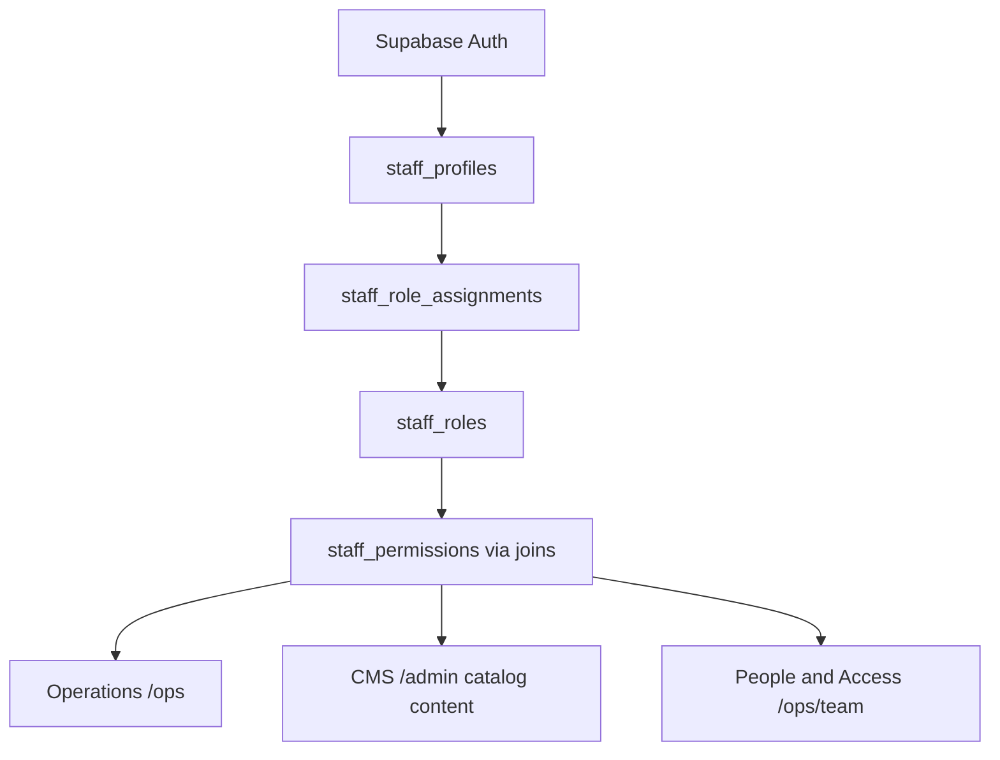

# Site plan Batch 01 — Admin roles

**Series:** [`SITE-BACKEND-PLAN.md`](./SITE-BACKEND-PLAN.md)  
**Status:** DRAFT (planning only — no build)  
**Date:** 2026-09-21  
**Reference Bank:** **RB-02 ACCESS** (GitHub Orgs/Teams · Supabase Auth + Postgres RLS)  
**Authority detail (existing):** [`pgs-v3-architecture/04-identity-rbac-permission-model.md`](./pgs-v3-architecture/04-identity-rbac-permission-model.md)

---

## WHAT this batch answers

Who are staff? What can each role do? Where is that enforced? What is already true in V3 vs what is only planned on paper? What must the owner decide before any role-related build?

Face cards, tags, Filling Fast, popups, and Ops modules **depend** on this spine — they are not planned here in depth.

---

## Product picture (ELI5)

```text
Supabase Auth (one identity pool)
        │
        ├── STUDENT login  → main public /login UI (students only for now)
        ├── GUARDIAN       → /login?surface=guardian → portal
        └── STAFF          → /login?surface=operations → same id
                              │
                              ├── Domain: Operations
                              ├── Domain: CMS
                              └── Domain: Student Operations
                                    │
                                    ├── Super Admin  → almost everything + who gets roles
                                    ├── Admin        → Ops + CMS (not role governance)
                                    ├── Mentor       → assigned students only
                                    └── Read-only    → look, don’t change (narrow)
```

**Domains of work ≠ separate password accounts.**  
Mentor (or Admin) uses **one id** and may open any staff domain their **permissions** allow.

**Role name alone is not authority.**  
Authority = permission keys on the role (+ scope: global vs assigned student).

**Premium is not a staff role.**  
**Student Viewer (guardian/teacher link) is not `read_only_staff`.**

---

## Canonical roles (target product language)

| Role key | UI label | Job in one line |
|---|---|---|
| `super_admin` | Super Admin | Own the system: Ops + CMS + who may be staff |
| `admin` | Admin | Run Operations and CMS for the org |
| `mentor` | Mentor | Work **assigned** students only |
| `read_only_staff` | Read-only staff | See permitted Ops data; no mutate |

**REJECT forever:** separate `ops_users` / `cms_users` / mentor-only **credential stores**. One staff identity → surface access by permission.

---

## Owner lock 2026-09-21 — domains ≠ separate profiles

Owner meaning (verbatim intent): **three different domains / surfaces for staff work**, not three user profiles. Same staff id can open CMS, admin/Ops, or student-operations pages. The **main public UI login is for students only**. Later: a **concentrated** student/guardian host (example: `feed.purpleguide.study`) so dashboard-only focus is possible — **deferred**, not Batch 01 build.

### Hostinger / legacy (read-only proof)

| World | Login | Behind it |
|---|---|---|
| Students | Public `/login` | Student app |
| **All staff** | One `pgs_admin` → `Users/login` | **CMS modules** + **student ops (`Users/*`)** + **super-admin staff CRUD (`Admins/*`)** |

Same `admin` table. Roles (Counselor/Admin/Super-admin) filtered the **sidebar**, not a second password. No `Cms` / `Mentor` / `Counselor` login controllers.

### V3 today (same idea)

| World | Login UI | After login |
|---|---|---|
| **Students** | Main `/login` (public UI) | Student surfaces |
| **Staff** | `/login?surface=operations` — **same** Supabase Auth user table | Permissions open surfaces |
| **Guardian** | `/login?surface=guardian` | Portal |

| Staff surface (domain of work) | URL family today | Same staff id? |
|---|---|---|
| Operations | `/ops/*` | Yes |
| CMS | `/admin/catalog`, `/admin/content`, `/cms` | Yes |
| Student Operations | `/ops/students/...` | Yes |
| People & Access | `/ops/team` | Yes (Super for invite) |

`/mentor` = bookmark alias into Ops students — **not** a second login.

```text
ONE staff credential
        │
        ├── Domain A — Operations (/ops)
        ├── Domain B — CMS (/admin/catalog · content · /cms)
        └── Domain C — Student Operations (/ops/students/…)
              (Mentor: only assigned students)
```

### Future host split (DEFERRED — owner idea, not building now)

| Host idea (example) | Who | Purpose |
|---|---|---|
| Main marketing / public site | Anonymous + student login | Public pages; student login UI stays here for now |
| Concentrated feed host e.g. `feed.purpleguide.study` | Students + guardians | Dashboard-only / focused app — “see things concentrated” without the full public chrome |

**Rules when that phase opens:**

- Still **one Auth** — not a new student password database  
- Route / host allowlists: student/guardian only on feed host; staff stay on Ops/CMS hosts  
- Exact subdomain names = owner deploy decision later (engineering gates already allow host-split thinking)

**NOT Batch 01:** implementing `feed.purpleguide.study`, moving student login off main site, or multi-host cookies.

---

## Authorization equation (locked idea)

```text
ALLOW =
  authenticated staff
  AND account/status valid
  AND has permission key for the operation
  AND scope predicate (global OR active mentor_assignments)
  AND entitlement predicate when the resource is Premium-only
```

Never: fetch all rows in React then hide. Unauthorized data must not leave RLS/server.

---

## Surfaces these roles open (preview of later batches)

| Surface | URL family | Batch that owns depth |
|---|---|---|
| People & Access | `/ops/team` | **01** (this doc) |
| Operations | `/ops/*` | **04** |
| Student Operations | `/ops/students` → student | **04** |
| CMS catalog / pages / modules | `/admin/catalog`, `/admin/content`, `/cms` | **02** |
| Popups | Track C / later | **03** |
| Security hardening | — | **05** |

---

## Honesty map — what V3 has TODAY

### EXISTS (certified spine)

| Piece | Where | Note |
|---|---|---|
| Auth identity | Supabase Auth | One user |
| Staff profile | `staff_profiles` | Not the permission source alone |
| Roles / permissions / grants | `staff_roles`, `staff_permissions`, `staff_role_permissions`, `staff_role_assignments` | Migration `202608130004_admin_cms.sql` |
| DB check | `private.has_staff_permission(key)` | RLS / RPC |
| Server context | `src/lib/staff-auth.ts` → `getStaffContext()` | Assignment → grants |
| People & Access | `/ops/team`, invite, detail | OPS-04 RPCs |
| Mentor scope | `mentor_assignments` | ONE mentor truth |
| Premium | `premium_entitlement` | Student capability, not role |
| Catalog publish gate | `catalog.manage` vs `catalog.publish` | Draft vs live |
| Layout gate | `/ops` + `/admin` share staff layout | Must be staff |
| **Ops searchable home** | `/ops` scoreboard + header `OperationsStaffSearch` + `AskPgsPanel` | **EXISTS** — owner product; permission `overview.read`; search hits students/catalog/pages/staff/work |
| Scoreboard RPC | `staff_operations_scoreboard` · scope org vs assigned | Mentor sees assigned implications, not org dump |

### Live role behavior (simplified)

| Role | Ops | CMS catalog/content | People & Access invite | Mentor students |
|---|---|---|---|---|
| Super Admin | Full | Full + publish | Yes (`roles.manage`) | Global |
| Admin | Full | Full + publish | **No** (no `roles.manage`) | Global |
| Mentor | Assigned workspace | No catalog manage (media.read only) | No | Assigned only |
| Read-only | Narrow read (OPS-04: overview + students.read) | No manage | No | N/A |

**Important:** Admin and Super Admin are **equal for catalog/CMS mutate** today. Super Admin’s extra is mainly **role governance** (`roles.manage`) and some share/governance powers — not a different CMS editor.

### TEMP / DRIFT (plan must resolve later — not code now)

| Gap | Issue |
|---|---|
| Doc vs DB permission names | Architecture doc lists `student_comments.*`, `scoreboard.read`, etc.; live DB/TS still lean on migration-004 keys (`student_workspace.*`, …) |
| TS allowlist | `staffPermissionKeys` in `staff-auth.ts` can drift from DB grants |
| “Unlock” product word | No permission named unlock — usually means **publish** or **Premium soft-lock** (owner must pick language) |
| Face / template edit | No `face_layout` permission yet — will sit under catalog manage/publish in Batch 02+ |

### MISSING / OWNER DECISION (before build)

| Decision | Options (for owner) |
|---|---|
| **D1 — Admin vs Super for CMS/catalog** | Keep equal (today) · Super-only publish · Super-only face/template change |
| **D2 — Read-only staff breadth** | Keep OPS-04 minimal · Restore read-only CMS/catalog peek · Custom |
| **D3 — Mentor may never…** | Confirm: no catalog edit, no People invite, no unassigned students (today’s intent) |
| **D4 — Student+staff same Auth** | Confirm OK (relational contexts) · product switching rules later |
| **D5 — “Unlock” language** | = publish live · = Premium unlock · = other |
| **D6 — Concentrated feed host** | Parked idea (`feed.purpleguide.study` example) — confirm **DEFERRED** until after Batches 01–05 · or name when to open |

---

## People & Access (how roles are given)

```text
Super Admin (roles.manage)
  → /ops/team
  → invite / assign role / revoke
  → staff_role_assignments (history-oriented)
  → effective permissions on next request
```

| Capability | Permission | Who today |
|---|---|---|
| See staff directory | `staff.read` | Admin, Super |
| Invite / change roles | `roles.manage` | **Super Admin only** |
| Mentor ↔ student assign | assignment RPCs + admin tools | Admin / Super (product Ops) |

**ADOPT (RB-02):** role = permission bundle; least privilege; grant/revoke with audit trail.  
**REJECT:** client-trusted role string; “Admin in React” without DB grant.

---

## Permission domains (vocabulary — map, don’t invent)

Grouped for planning. Exact key migration is Batch 05 / build-time.

| Domain | Example keys (live or target doc) | Used by |
|---|---|---|
| Overview | `overview.read` | Ops home / scoreboard entry |
| Students / workspace | `students.read`, `student_workspace.*` (live) | Registry + Student Ops |
| Catalog | `catalog.read` / `.manage` / `.publish` | CMS Batch 02 |
| CMS pages | `cms.read` / `.manage` / `.publish` | CMS Batch 02 |
| Content modules | `content.*` | CMS Batch 02 |
| Media | `media.*` | Both Ops + CMS |
| Staff governance | `staff.read`, `roles.manage` | People & Access |
| Audit | `audit.read` | Ops activity |
| Premium / mentors | `premium.*`, assignment manage | Access console + Ops |

Comments / notes / alerts as **named** keys appear stronger in the architecture doc than in every live grant — Batch 04 + 05 must reconcile without inventing a second comments table (`workspace_comments` remains conversation truth).

---

## Connection map (roles only)

```text
Browser /ops or /admin
  → staff session
  → getStaffContext()
  → permission set from staff_role_assignments → staff_role_permissions
  → route requireStaffPermission(key)
  → Postgres RLS / private.has_staff_permission(key)
  → for mentors: + mentor_assignments scope on student rows
```



---

## Reference Bank — RB-02 ACCESS

| Verdict | Lesson |
|---|---|
| **ADOPT** | Org/team membership; role vs permission; least privilege; grant/revoke; server+RLS enforcement |
| **ADAPT** | Onto existing `staff_*` tables + `/ops/team` — do not replace with a new IdP |
| **REJECT** | Separate Ops login; JWT role as sole authority; hide-unauthorized-in-React |

---

## ADOPT / ADAPT / REJECT (Batch 01)

| | Item |
|---|---|
| **ADOPT** | Four role keys; permission-shaped access; People & Access Super-only invite; mentor assignment scope; Premium ≠ role; **one staff id across CMS + Ops + Student Ops domains** (Hostinger `pgs_admin` pattern); **Ops searchable dashboard + scoreboard/Ask PGS overview** (already built) |
| **ADAPT** | Align doc permission catalog ↔ DB ↔ TS allowlist (later build gate); clarify Admin vs Super for publish/face when owner decides D1; later **host split** (e.g. feed subdomain) without new credential stores |
| **REJECT** | `ops_users` / `cms_users`; separate mentor/CMS/ops **passwords**; treating `staff_profiles.role` display string as authority; inventing unlock permission without owner meaning |

---

## What Batch 01 does **not** cover

- How CMS editors / drafts / live preview work → **02**  
- Popup triggers and SoftLock → **03**  
- Student registry, scoreboard, workspace modules → **04**  
- Full security / IDOR / audit posture → **05**  
- Face card UI or `face_layout` schema → after site plan + catalog B\*  

---

## Owner checklist (mark before READY 01)

- [ ] D1 Admin vs Super for CMS/publish/face — pick  
- [ ] D2 Read-only staff breadth — pick  
- [ ] D3 Mentor hard stops — confirm  
- [ ] D4 Student+staff same Auth — confirm  
- [ ] D5 Meaning of “unlock” — pick  
- [ ] D6 Feed concentrated host — leave **DEFERRED** or schedule  
- [ ] Anything wrong in honesty map / domain lock — correct here  

When done: reply **`READY 01`** (or list edits). Then we draft **Batch 02 — CMS**.

---

## How we will build later (preview only)

Not now. After Batches 01–05:

```text
Possible first build gates (owner picks later):
  G-roles-reconcile  → permission key honesty + tests (no product invent)
  G-people-qc        → People & Access click matrix
  … then CMS / Ops / security gates from later batches
```

Each build: map → propose → `GO AHEAD Gn` → one gate → living MD update → owner click QC.
