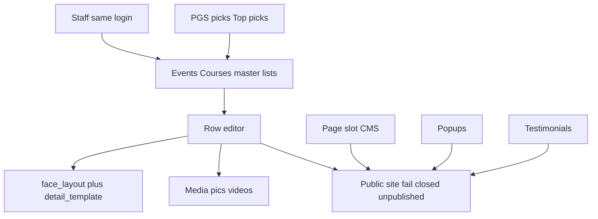
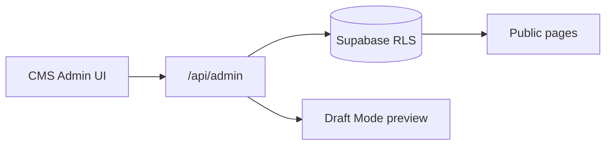

# Site plan Batch 02 — CMS

**Series:** [`SITE-BACKEND-PLAN.md`](./SITE-BACKEND-PLAN.md)  
**After:** Admin ([`PGS-ADMIN-OPS.md`](./PGS-ADMIN-OPS.md))  
**Before:** Student Operations  
**Status:** DRAFT — owner mental model locked in · planning only · **no product code**  
**Date:** 2026-09-21  
**CMS living map:** [`PGS-CMS.md`](./PGS-CMS.md) · skill `pgs-cms`  
**Reference Bank:** **RB-09** · **RB-10** (Contentful feel · [`payloadcms/payload`](https://github.com/payloadcms/payload) study only — **do not install**)  
**Stack:** Next.js · Supabase · shadcn · RHF+Zod · Draft Mode · existing `/admin/catalog` · `/admin/content` · `/admin/media`

---

## WHAT CMS is (owner picture)

CMS is where staff **add and maintain product content**: courses, events, page copy, pics/videos, popups, UnivMeet, country/USMLE content, testimonials, and **curated rails** (PGS picks / Top picks) that pick from **existing** catalog rows. Same staff login as Ops — **not** a second CMS password.

```text
SAME staff cookie
  ├── Ops /ops     → health overview
  └── CMS /admin/… → create · edit · publish · archive · tag · media · popups · pages
```

---

## Mental model — CMS sections

```text
CMS
 ├── 1. EVENTS master        list · live · edit · archive · sort · tags · calendar
│         └── per event: detail template (lite/courses/…) + face_layout + Zoho/booking URL
├── 2. COURSES master       same pattern as events
├── 3. PROGRAMS / UNIS      catalog siblings
├── 4. POPUPS               edit popup contents · SoftLock / bump / marketing (Track C timing)
├── 5. TESTIMONIALS         add · pick · archive
├── 6. PGS PICKS / TOP PICKS  select existing events+courses into groups (not invent new rows)
├── 7. PAGE WRITING         countries · USMLE · UnivMeet-related · other typed page slots
├── 8. MEDIA                pics · videos · change/replace
├── 9. TAGS                 group/filter events & courses
└── 10. BLOGS / ARTICLES    later (articles module EXISTS; “blog product” may deepen later)
```



---

## Honesty map (V3 today)

| Owner want | V3 today | Status |
|---|---|---|
| Events / courses master (list, live, edit) | `/admin/catalog/events` · `courses` · draft/publish | **EXISTS** |
| Archive | Unpublish / hide (`published: false`) — no separate “archive” state UI | **PARTIAL** |
| Sort by date created | List order / `order` fields — created-at sort UX may be weak | **PARTIAL** |
| Tags on events/courses | `catalog_tags` + tag-links API | **EXISTS** |
| Calendar view of events/courses | No admin calendar UI; weak upcoming/past filter | **MISSING** |
| Detail template + face card picker | Face inventory fixtures; columns = B\* | **MISSING** DB/UI (see [`CATALOG-B-STAR.md`](./CATALOG-B-STAR.md)) |
| Zoho / webinar link | `events.booking_url` (+ `meeting_slots.booking_url`) | **EXISTS** field |
| Pics / videos / change media | `/admin/media` + inline media fields (jpg/png/webp/gif/pdf/mp4) | **EXISTS** |
| Testimonials add / archive | Content module `testimonials` | **PARTIAL** — admin CRUD; public pages often still static fixtures |
| FAQs / highlights | Content modules | **PARTIAL** — same (admin vs public wire) |
| Top picks / Most wanted | `featured` boolean on courses/programs | **EXISTS** (flag) |
| PGS picks / USMLE surfaces | `card_surfaces` keys in TS (`pgs_picks`, `usmlerotation`, …) | **PARTIAL** — no certified DB column · **no admin toggle UI** |
| Country page content | CMS page slots + modular country bodies; catalog `countries` = lookup | **PARTIAL** |
| USMLE / rotation page copy | CMS pages `usmlerotation` string slots | **PARTIAL** |
| UnivMeet slots | `meeting_slots` module | **EXISTS** admin |
| Live activity / PGS picks on USMLE page | Frontend modules exist; CMS selection incomplete | **PARTIAL** |
| Popups edit (contents, triggers) | Public login popup leftovers; SoftLock planned Track C | **MISSING** admin popup CMS |
| Blogs | `articles` module | **EXISTS** light · “blog product” later |
| Page builder / free HTML | Forbidden | **REJECT** |
| Junior Canva visual editors | `.ref` leave alone | **REJECT** as forever CMS |

---

## Section contracts (target product)

### 1–2. Events & Courses master

| Capability | Contract |
|---|---|
| Master list | Search · filter · sort (created / start date) · tag filter |
| Lifecycle | Draft → preview → **live (published)** → unpublish/archive |
| Row editor | Title, dates, media, copy fields, `booking_url` (Zoho/webinar), tags |
| Presentation | `detail_template` + `face_layout` (one desk+mob pair) — B\* / face gates |
| Calendar | Optional calendar view of start dates — **MISSING** UI |

**FE→BE:** `/admin/catalog/[entity]` → `/api/admin/catalog/*` → tables + drafts · `catalog.publish` for live.

### 3. Programs / Universities

Same catalog pattern; programs `featured` = Most Wanted style.

### 4. Popups

| Capability | Contract |
|---|---|
| Edit copy/media/CTA | Typed popup modules (not free HTML) |
| Link out | External webinar/Zoho URL where product needs it |
| Triggers | Page/button map — owner Figma first (Track C) |

**Status:** **MISSING** as CMS — do not invent SoftLock 2.0 during early CMS gates. Named `GO AHEAD popups` later.

### 5. Testimonials

Add · edit · publish/archive · optional “pick for page X”.  
Admin module **EXISTS**; public wire **PARTIAL**.

### 6. PGS picks & Top picks

```text
Pick from EXISTING published events and/or courses
  → membership in a named rail (pgs_picks | top_picks | usmlerotation | …)
  → public page reads membership — fail closed if unpublished
```

**ADAPT** junior/V3 `card_surfaces` idea → real DB + admin UI (B\* / CMS gate).  
**REJECT** creating duplicate course rows only for a rail.

### 7. Page writing (countries, USMLE, …)

Typed **slots** per page (`cms_pages` / revisions) — change copy, not layout.  
Countries / USMLE / Premium pathways: Figma bodies stay; CMS fills approved strings/media.

### 8. Media

Central library + per-field attach. Replace pic/video = new asset + update field.

### 9. Tags

One `catalog_tags` vocabulary · joins · used for CMS filter **and** later Admin overview / search.

### 10. Blogs / articles

`articles` module now; richer blog IA only if owner opens it by name.

---

## Permissions (same staff id)

| Key | Use |
|---|---|
| `catalog.read` / `.manage` / `.publish` | Events · courses · programs · unis · tags |
| `cms.read` / `.manage` / `.publish` | Typed page slots |
| `content.read` / `.manage` / `.publish` | Testimonials · FAQs · articles · meeting_slots · … |
| `media.read` / `.manage` | Pics / videos |

Mentor: typically **no** catalog manage. Super/Admin: CMS mutate. Never “shared login = edit everything” without grants.

---

## Reference Bank — GitHubs, apps, what to steal

**Authority order:** Owner mental model → Figma/PGS Flow → existing V3 CMS/catalog → Hostinger/junior (read-only) → Reference Bank (lowest).

Full bank rules: `.cursor/rules/pgs-v3-reference-bank.mdc` · architecture: [`pgs-v3-architecture/10-cms-and-catalog-architecture.md`](./pgs-v3-architecture/10-cms-and-catalog-architecture.md).

### Primary (CMS)

| Bank | Mature app (feel) | OSS GitHub (study) | Framework (locked) | Steal for PGS |
|---|---|---|---|---|
| **RB-09 CMS CORE** | [Contentful](https://www.contentful.com/) | [`payloadcms/payload`](https://github.com/payloadcms/payload) | shadcn · RHF · Zod | Collections · fields · relationships · validation · role-aware editing |
| **RB-10 CMS PUBLISHING** | Contentful publish/preview | Payload draft/publish patterns | **Next.js Draft Mode** | Draft vs published · preview · publish authority · rollback mindset |

**How to study (15–30 min each, no dump):**

| Source | Click / read | Take notes as |
|---|---|---|
| Contentful | Content model → entry → publish → preview | APP LESSONS |
| Payload docs/repo | Collections · drafts · access control | OSS LESSONS |
| Our stack | `/admin/catalog` · `/admin/content` · Draft Mode preview API | ADAPT target |

**REJECT forever:** `pnpm add payload` · embedding Payload admin · page builder · AGPL dump into pgs-v3.

### Supporting banks (CMS-adjacent)

| Bank | App / GitHub | When CMS uses it |
|---|---|---|
| **RB-01** | HubSpot · [`twentyhq/twenty`](https://github.com/twentyhq/twenty) | Events/courses **master list** UX (filters, sort, saved feel) |
| **RB-02** | GitHub Orgs · [`supabase/supabase`](https://github.com/supabase/supabase) | Who may `catalog.*` / `cms.*` — same staff id |
| **RB-08** | Drive · [`paperless-ngx/paperless-ngx`](https://github.com/paperless-ngx/paperless-ngx) | Media organize/replace patterns — **not** new storage architecture (Phase 4D stays student docs) |
| **RB-11** | Contentful rich text · Lexical | **Only** if a named field needs rich text — never whole-page HTML |
| Face / templates | Figma + `pgs-face-card-pass` | Card picker on event/course row |

### Existing PGS projects (not external)

| Source | Role |
|---|---|
| Live V3 `/admin/catalog` · `/admin/content` · `/admin/media` | **Build on this** — do not replace |
| Hostinger `pgs_admin` CMS modules | Business intent (events, courses, unis, …) — insecure PHP **REJECT** |
| Junior `.ref/pgs_app` Canva editors | Shape only — **REJECT** as forever CMS |
| [`admin-registry.ts`](../src/lib/admin-registry.ts) | Entity field authority today |
| Face lab / CATALOG-B-STAR | `face_layout` · `detail_template` · picks surfaces |

### Locked implement stack

| Layer | Choice |
|---|---|
| App | Next.js App Router · React · TypeScript · Vercel |
| DB | Supabase Postgres · RLS · RPCs · draft revisions |
| UI | shadcn · Lucide · TanStack Table (master lists) |
| Forms | React Hook Form + Zod |
| Preview | Next.js Draft Mode (pages) · catalog preview API |

---

## Detailed game plan (phases)

**Rule:** one named gate · propose → `GO AHEAD CMS-n` → implement → update this MD → owner QC → stop.  
Prefer lab/preview until owner pulls live. No silent jump to popups or face DB.

```text
CMS-0  Plan QC (this doc)
  ↓
CMS-1  Events + Courses master list UX
  ↓
CMS-2  Media attach/replace QC
  ↓
CMS-3  Testimonials (+ FAQs) public wire
  ↓
CMS-4  Picks rails admin (PGS picks / Top picks / surfaces)
  ↓
CMS-5  Calendar view (optional — owner P0?)
  ↓
CMS-6  Page slots deepen (countries / USMLE / …)
  ↓
CMS-7  Tags + sort + archive clarity polish
  ↓
B* / FACE  detail_template + face_layout on row (coord CATALOG-B-STAR)
  ↓
CMS-P  Popups (only GO AHEAD popups + Figma)
  ↓
CMS-B  Blogs deepen (only if owner names it)
```

### CMS-0 — Plan lock

| | |
|---|---|
| **Out** | Owner answers archive / picks UI / popups timing / calendar P0 |
| **Do** | Mark READY 02 · no code |
| **Study** | Contentful entry lifecycle · this honesty map |

### CMS-1 — Events & Courses master

| | |
|---|---|
| **Goal** | Master list feels operable: search, tag filter, sort by created/start, clear Live vs Draft vs Unpublished |
| **FE** | `/admin/catalog/events` · `courses` toolbar |
| **BE** | Existing catalog APIs — **no** new domain |
| **Bank** | RB-01 list patterns · RB-09 field validation |
| **Day-1 security** | `catalog.manage` / `.publish` · published mutate needs publish · same deny for missing/unauthorized |
| **QC** | Create draft → preview → publish → unpublish · tag filter · sort |
| **NOT** | Face picker · calendar · popups |

### CMS-2 — Media

| | |
|---|---|
| **Goal** | Add/replace pic or video on event/course and via `/admin/media` |
| **FE/BE** | Existing media API + inline fields |
| **Bank** | RB-08 organize/replace lessons only |
| **Day-1** | `media.manage` · allowlisted MIME · size cap |
| **NOT** | Student private docs (Phase 4D) |

### CMS-3 — Testimonials (and FAQ if same pattern)

| | |
|---|---|
| **Goal** | Admin add/archive → **public page reads DB** (kill static-only drift where approved) |
| **FE** | `/admin/content/modules/testimonials` → public consumers |
| **BE** | `testimonials` (+ faqs) · `content.publish` |
| **Day-1** | Unpublished not on public · no IDOR on draft |
| **NOT** | Redesign testimonial Figma layout |

### CMS-4 — PGS picks / Top picks

| | |
|---|---|
| **Goal** | Staff multi-select **existing published** courses/events into named rails |
| **Contract** | Rail key ∈ {`featured` / `pgs_picks` / `usmlerotation` / …} · membership table or certified `card_surfaces` column — **exact schema at gate propose** |
| **FE** | Dedicated picks UI or catalog toggles |
| **Public** | USMLE `#Pgs picks` / Top picks read membership · fail closed |
| **Bank** | RB-09 relationships |
| **Day-1** | Cannot put unpublished row on public rail · permission `catalog.manage` |
| **REJECT** | Duplicate fake course rows for a rail |
| **Coord** | USMLE frontend · `card-surfaces.ts` · CATALOG-B-STAR |

### CMS-5 — Calendar view

| | |
|---|---|
| **Goal** | Calendar of event/course start dates → click through to editor |
| **Depends** | CMS-1 stable |
| **Owner** | Confirm P0 vs defer |
| **Day-1** | Same catalog permissions · no leak of drafts on public calendar |

### CMS-6 — Page writing (countries, USMLE, …)

| | |
|---|---|
| **Goal** | Typed slots only — edit copy/SEO/approved media; **layout stays Figma/code** |
| **FE** | `/admin/content/pages/[slug]` |
| **BE** | `cms_pages` · revisions · Draft Mode preview |
| **Bank** | RB-10 preview/publish |
| **Day-1** | `cms.publish` for live · preview cookie not a public bypass |
| **NOT** | Page builder · invent new slots without Figma |

### CMS-7 — Tags / sort / archive polish

| | |
|---|---|
| **Goal** | Tag CRUD clarity · created-at sort · archive labeling (or confirm unpublish = archive) |
| **Depends** | CMS-1 |

### FACE / B\* — Template + face on row

| | |
|---|---|
| **Goal** | Staff pick `detail_template` + `face_layout` on event/course |
| **Skills** | `pgs-face-card-pass` · CATALOG-B-STAR |
| **Not CMS-1** | Separate named gates after faces exist in Figma |

### CMS-P — Popups

| | |
|---|---|
| **Goal** | Edit popup content · CTA · optional Zoho/webinar URL · trigger map |
| **Requires** | Owner Figma desktop+mob · `GO AHEAD popups` |
| **ADAPT** | SoftLock / BumpPremium — no second popup system |
| **Park** | Until catalog master + picks are good enough unless owner reorders |

### CMS-B — Blogs

Only if owner says so. `articles` module already light-EXISTS.

---

## Connection map (every CMS gate)

```text
Staff UI (/admin/catalog|content|media)
  → requireStaffPermission(domain.*)
  → /api/admin/...
  → Postgres RLS + publish triggers
  → Public site reads published only (fail closed)
  → audit where wired
```



---

## Game-plan checklist (owner)

- [ ] Study Contentful publish flow once (feel)  
- [ ] Skim Payload collections docs (patterns) — no install  
- [ ] Click live `/admin/catalog/events` + `/admin/content/pages`  
- [ ] Answer owner decisions (archive · picks UI · popups · calendar)  
- [ ] `READY 02` → Student Ops plan **or** `GO AHEAD CMS-1` when ready to build  

---

## Owner decisions

1. **Archive** = `published: false` enough, or need explicit `archived` status?  
2. **Picks:** one multi-select UI for `pgs_picks` + `featured`, or separate screens?  
3. **Popups:** park until after catalog master + picks, or open earlier?  
4. **Calendar:** P0 or nice-to-have after master list?  
5. Anything in your mental model missing from the section list above?

---

## How to continue

| You say | What happens |
|---|---|
| Edits to this mental model / game plan | Update this MD + `pgs-cms` skill |
| `READY 02` | Lock CMS plan · Student Ops already drafted ([`SITE-PLAN-02b-STUDENT-OPS.md`](./SITE-PLAN-02b-STUDENT-OPS.md)) |
| `GO AHEAD CMS-1` | First build gate only — master list UX |

Companions: `pgs-cms` · `pgs-admin-ops` · `pgs-face-card-pass` · `pgs-propose-before-code` · `pgs-backend-phase-wire`.
