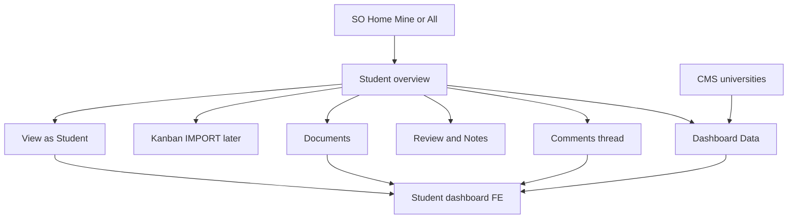

# Site plan Batch 02b — Student Operations

**Series:** [`SITE-BACKEND-PLAN.md`](./SITE-BACKEND-PLAN.md)  
**After:** Admin · CMS  
**Before:** Popups (03) · Security spine (05)  
**Status:** **LOCKED for series** — owner READY 02b · planning only · deepen with named `GO AHEAD SO-…` later · **no product code from this lock alone**  
**Date locked:** 2026-09-21  
**Skill:** `.cursor/skills/pgs-student-ops/SKILL.md`  
**Living map:** [`PGS-STUDENT-OPS.md`](./PGS-STUDENT-OPS.md)  
**Architecture:** [`pgs-v3-architecture/07-student360-model.md`](./pgs-v3-architecture/07-student360-model.md)  
**Student Profile (PARKED 02c):** [`SITE-PLAN-02c-STUDENT-PROFILE.md`](./SITE-PLAN-02c-STUDENT-PROFILE.md) · [`PGS-STUDENT-PROFILE.md`](./PGS-STUDENT-PROFILE.md) · skill `pgs-student-profile`

### Owner refs (saved)

| Ref | File | Use |
|---|---|---|
| Hostinger Manage Dashboard | [`site-plan-refs/hostinger-student-ops-dashboard-data.png`](./site-plan-refs/hostinger-student-ops-dashboard-data.png) | Tabs · dashboard metrics · university shortlist from CMS |
| Inbox / thread feel | [`site-plan-refs/ref-student-ops-inbox-chatwoot-style.jpg`](./site-plan-refs/ref-student-ops-inbox-chatwoot-style.jpg) | Assigned home · Mine/All · thread · Reply vs Private Note · @helpers |

---

## WHAT (owner picture — locked)

Student Operations is where **assigned** Admins/Mentors run a student’s Premium life. **Super Admin sees all students.** Everything the student sees on their dashboard (metrics, shortlist, docs, onboarding checklist, feedback session, draft meter / progress, counselor notes, review queue, comments, …) is **edited here** — one truth, not a second database.

```text
HOME = my assigned students (group / sort)
  → open one student OVERVIEW
  → tabs: Dashboard Data · Comments · Review & Notes · Docs · …
  → Kanban = IMPORT later (owner building separately)
  → View as Student = real student dashboard (guide them)
```

```text
SAME staff cookie
  Mentor / Admin  → only assigned students (mentor_assignments)
  Super Admin     → all students
  Extra helpers   → @mention into that student’s comment thread (proposed)
```

**Universities:** master list lives in **CMS** (`/admin/catalog` universities). Mentor/Admin **choose** from that list into the student’s shortlist here.

**Kanban:** owner builds separately → **import into this workspace when ready**. Do not redesign board complexity inside SO gates until import.

---

## Visual plan

### Screen A — Student Ops home (assigned list)

**Feel:** Chatwoot-style inbox list (ref 2) · **not** a marketing page.

```text
┌────────────┬──────────────────────────────┬─────────────────────┐
│ OPS nav    │  STUDENTS                      │  Filters            │
│            │  [ Mine ] [ Mentions ] [ All* ]│  Pathway · Tag ·   │
│ Students ● │  * All = Super / read_all only │  Docs pending · …  │
│            │────────────────────────────────│                     │
│            │  ○ Priya     Mentor: Anjay     │  Groups (later):    │
│            │    last: “Need LoR help”  2h   │  Onboarding ·       │
│            │    tags: docs-pending          │  Shortlisting · …   │
│            │  ○ Ayush     Mentor: Meera     │                     │
│            │    last: staff note …     1d   │                     │
└────────────┴──────────────────────────────┴─────────────────────┘
```

| Actor | List |
|---|---|
| Mentor / Admin (assigned scope) | **Mine** only |
| Super Admin (`student_workspace.read_all`) | **All** + Mine |
| @mentioned helper (proposed) | **Mentions** queue |

**TODAY:** `/ops/students` registry **EXISTS** (search/filters/assign). Mentions group + rich last-comment preview = **PARTIAL / GAP**.

---

### Screen B — One student shell (overview → tabs)

**Feel:** Hostinger “Manage Dashboard: Ayush” (ref 1) + right rail identity (ref 2).

```text
┌──────────────────────────────────────────────────────────────┐
│  Manage: Ayush     Premium ●     Mentor: Meera               │
│  [ View as Student ]                                         │
│  Dashboard / Students / Ayush                                │
├──────────────────────────────────────────────────────────────┤
│  [ Dashboard Data ] [ Comments ] [ Review & Notes ]          │
│  [ Documents ] [ Kanban ⚠ import later ]                     │
├────────────────────────────┬─────────────────────────────────┤
│  ACTIVE TAB CONTENT        │  Overview rail                  │
│                            │  pathway · intake               │
│                            │  docs count · alerts            │
│                            │  uni shortlist count            │
│                            │  last comment snippet           │
└────────────────────────────┴─────────────────────────────────┘
```

**Owner rule:** each student has an **overview of their contents**, then staff go in tab-by-tab to do the rest.

---

### Screen C — Dashboard Data tab (Hostinger parity)

```text
┌─ Quick Dashboard Overview ─────────────────────┐
│  UNI APPLIED [ 2 ]     OFFERS RECEIVED [ 2 ]   │
│  ☐ Tuition receipt uploaded                    │
│  ☐ Visa applied                                │
│  + onboarding checklist · feedback session     │
│  + documents tracker · currently working on    │
│  (same fields student Premium dashboard reads) │
└────────────────────────────────────────────────┘
┌─ Finalized Universities ──────── [+ Add] ──────┐
│  [ Select university ▾ ]  (from CMS master)    │
│  optional logo override · delete               │
│  “Add more in University Management” → CMS     │
└────────────────────────────────────────────────┘
```

**V3 truth today:** `premium_workspace_profiles` (metrics/checklists) · `student_university_selections` → `universities` catalog. Staff UI exists but is **not** Hostinger-tabbed yet (**ADAPT** layout).

---

### Screen D — Comments tab (concentrate here)

**Feel:** Chatwoot Messages + Reply / Private Note + @mentions (ref 2).  
**Authority:** one table `workspace_comments` — never a second comments system.

```text
┌─ Comments: Ayush ───────────────────────────────────────────┐
│  Thread (chronological)                                     │
│  ┌ Student ───────────────────────────────────────────────┐ │
│  │ Ayush · 10:02  “Can you check my LoR?”                 │ │
│  └────────────────────────────────────────────────────────┘ │
│  ┌ Mentor (student_visible) ──────────────────────────────┐ │
│  │ Meera · 10:15  “Upload the draft under Documents.”     │ │
│  └────────────────────────────────────────────────────────┘ │
│  ┌ Staff only (student NEVER sees) ───────────────────────┐ │
│  │ Meera · 10:16  “@Anjay can you jump in on LoR?”        │ │
│  └────────────────────────────────────────────────────────┘ │
│  ┌ Helper joined (student_visible or staff_only) ─────────┐ │
│  │ Anjay · 11:00  “Happy to help — send the outline.”     │ │
│  └────────────────────────────────────────────────────────┘ │
├─────────────────────────────────────────────────────────────┤
│  [ Reply (student sees) ]  [ Private note (staff only) ]    │
│  ________________________________________________________   │
│  @mention staff to involve as helper · Send                 │
└─────────────────────────────────────────────────────────────┘
```

#### Who can be in the thread

| Actor | Access |
|---|---|
| **Assigned mentor / Admin** | Full thread for assigned students |
| **Super Admin** | **Any** student’s comments (org scope) |
| **@mentioned helper** (proposed) | Temporary / explicit involvement on that student thread — not company-wide dump |
| **Student** | Only `visibility = student_visible` rows |
| **Viewer / guardian** | Never counselor notes; comments only if product later allows — default **no staff_only** |

#### Already in V3 (ADOPT)

| Piece | Evidence |
|---|---|
| Thread via `parent_id` | `workspace_comments` |
| Reply vs private | `visibility`: `student_visible` \| `staff_only` |
| Notify student on mentor visible comment | trigger → notifications |
| Scope | `can_access_premium_student` · mentor assignment · privileged staff |

#### GAP / propose later (do not invent silently)

| Need | Proposed contract (owner must approve before migrate) |
|---|---|
| **@mention helpers** | Mention rows or `workspace_comment_participants` / notification to mentioned staff · Mentions inbox filter |
| **“Add helper” without full mentor assign** | Explicit participant grant on **this student only** (not `mentor_assignments` replace) |
| Student FE comments UI | Still may be **fixture** — wire to same table (SO-3) |
| Staff UI Compose Reply/Note tabs | ADAPT current panels toward Chatwoot compose |

**REJECT:** second comment table for feed · student seeing private notes · @mention granting org-wide student access · dumping Chatwoot into the repo.

---

### Screen E — Review & Notes / Documents

```text
Review & Notes
  ├── Review queue items (student-visible flag)
  ├── Counselor notes (staff_only default — never leak to student FE)
  └── Important alerts

Documents
  ├── Requirements list
  ├── Uploaded files · QC status (Phase 4D)
  └── Staff review actions → student notifies
```

---

### Screen F — Kanban (PARKED)

```text
┌─ Kanban Board ─────────────────────────────────┐
│  ⚠ Owner building separately                   │
│  When ready: IMPORT board component here       │
│  Same truth: student_tasks · board_columns     │
│  Do NOT redesign board in early SO gates       │
└────────────────────────────────────────────────┘
```

Legacy Hostinger tab stays in the IA. V3 already has `StaffKanbanBoard` — treat as **placeholder until owner import**.

---

### Screen G — View as Student

```text
[ View as Student ] → short-lived preview cookie
  → REAL student Premium / feed routes
  → banner “Staff preview · read-only”
  → Exit returns to Student Ops
```

**REJECT:** ask student password · fake staff-only copy of dashboard · mutate while previewing.

---

## How things work (connection map)

```text
CMS universities master
        │
        ▼
Student Ops shortlist ──► student_university_selections
Student Ops dashboard fields ──► premium_workspace_profiles
Student Ops docs review ──► Phase 4D student_documents
Student Ops comments ──► workspace_comments (+ mentions later)
Student Ops notes/reviews/alerts ──► counselor_notes · review_queue · student_alerts
        │
        ▼
Student Premium dashboard / feed / upload_your_doc  (SAME rows)
```



**Scope:**

```text
auth user → staff profile → permissions
  → Super: read_all / manage_all → all students
  → Mentor/Admin: mentor_assignments → assigned only
  → Helper @mention (proposed): participant on that student only
Unauthorized = same as missing (no IDOR oracle)
```

---

## Reference Bank — lots of refs (patterns only)

| Bank | App | GitHub / feel | Steal for Student Ops |
|---|---|---|---|
| **RB-05** | Intercom Inbox | [`chatwoot/chatwoot`](https://github.com/chatwoot/chatwoot) | **Comments:** thread · Reply vs Private Note · @mentions · Mine/Mentions/All |
| **RB-04** | Linear Inbox | Chatwoot | Mention notifications · deep link to student thread |
| **RB-01** | HubSpot | [`twentyhq/twenty`](https://github.com/twentyhq/twenty) | Assigned student list · tags · record detail |
| **RB-06** | Linear | [`makeplane/plane`](https://github.com/makeplane/plane) | Kanban **after import** — patterns only |
| **RB-07** | Linear | Plane | Review queue · alerts |
| **RB-08** | Drive | [`paperless-ngx/paperless-ngx`](https://github.com/paperless-ngx/paperless-ngx) | Doc review UX · Phase 4D wins storage |
| **RB-02** | GitHub Orgs | [`supabase/supabase`](https://github.com/supabase/supabase) | Super vs mentor scope · helper grants |
| **RB-09** | Contentful | Payload study | Universities master (CMS) feeding shortlist |
| Hostinger | Manage Dashboard Ayush | saved PNG | Tab IA · dashboard metrics · uni picker |
| Inbox ref | Chatwoot-style JPG | saved | Home list · compose · helpers |

**Do not install** Chatwoot / Twenty / Plane. Implement on shadcn + Supabase + existing tables.

### Chatwoot study checklist (comments)

| Click in Chatwoot | PGS ADOPT / ADAPT / REJECT |
|---|---|
| Mine / Mentions / All | **ADAPT** → assigned / @mentions / Super all |
| Reply vs Private Note | **ADOPT** → `student_visible` / `staff_only` |
| @agent in note | **ADAPT** → @staff helper participant (propose schema) |
| Canned responses `/` | **DEFER** unless owner asks |
| Full Chatwoot product embed | **REJECT** |

---

## Honesty map (current V3)

| Module | Status | Notes |
|---|---|---|
| Assigned registry home | **EXISTS** | `/ops/students` · mentor scope |
| Super sees all | **EXISTS** | `student_workspace.read_all` |
| Hostinger tabbed Manage shell | **PARTIAL** | Page is stacked panels, not tabs yet |
| Dashboard metrics / checklists | **EXISTS** | `premium_workspace_profiles` |
| University shortlist from CMS | **EXISTS** | selections → universities |
| Comments thread + visibility | **EXISTS** | staff path; student FE may be fixture |
| @mention helpers / Mentions inbox | **MISSING** | propose before migrate |
| Counselor notes / reviews / alerts | **EXISTS** | |
| Documents Phase 4D | **EXISTS** | |
| View as Student | **EXISTS** | env config **PARTIAL** |
| Kanban | **EXISTS** placeholder · **PARK** for owner import | |
| Groups on home | **PARTIAL** | tags/filters exist; Hostinger-style folders later |

Page: `src/app/admin/students/[studentId]/page.tsx` · API: `/api/staff/students/[id]/workspace/[resource]`.

---

## Game plan (revised for this mental model)

```text
SO-0   Plan QC (this doc + owner decisions)
SO-1   Home = assigned list · Mine / All · open overview
SO-2   Student shell: overview rail + tab IA (Hostinger tabs)
SO-3   Dashboard Data + university shortlist (CMS picker)
SO-4   COMMENTS deep — thread UI · Reply/Private · Super on any
SO-5   @mention helpers + Mentions queue (schema propose → GO AHEAD)
SO-6   Review & Notes · Documents QC
SO-7   View as Student harden
SO-K   Kanban IMPORT (only when owner board ready)
SO-8   Groups / folders on home (optional)
SO-9   Load shape summary + lazy tabs (perf)
```

**Kanban:** skip inventing board UX until `GO AHEAD SO-K`.

---

## Owner decisions

1. **Home default:** Mine only for mentors; Super lands on All or Mine?  
2. **Helpers:** @mention = notification only, or real **participant grant** on that student?  
3. **Private notes:** stay inside `workspace_comments.staff_only`, or also use `counselor_notes` for longer memos? (Recommend: chat private = comments; long memos = counselor_notes.)  
4. **Tab set v1:** Dashboard Data · Comments · Review & Notes · Documents · (Kanban stub)?  
5. **When to import Kanban** relative to comments (SO-4/5)?

---

## How to continue

| You say | What happens |
|---|---|
| Picture change | Re-propose · re-lock if contract moves |
| `GO AHEAD SO-n` | One build gate only (plan lock ≠ build) |
| Next series | Draft **Batch 03 — Popups** |

Companions: `pgs-student-ops` · `pgs-student-profile` (02c PARKED) · `pgs-admin-ops` · `pgs-cms` · `pgs-backend-phase-wire` · `pgs-propose-before-code`.
