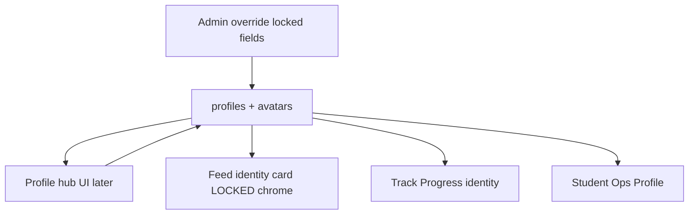

# Site plan Batch 02c — Student Profile (Facebook-style identity hub)

**Series:** [`SITE-BACKEND-PLAN.md`](./SITE-BACKEND-PLAN.md)  
**Beside:** Student Ops [`SITE-PLAN-02b-STUDENT-OPS.md`](./SITE-PLAN-02b-STUDENT-OPS.md) · Feed [`STUDENT-FEED-MODULAR.md`](./STUDENT-FEED-MODULAR.md)  
**Status:** **PARKED findings** — owner capture **2026-09-22** · planning only · **no product code from this note alone**  
**Skill:** `.cursor/skills/pgs-student-profile/SKILL.md`  
**Living map:** [`PGS-STUDENT-PROFILE.md`](./PGS-STUDENT-PROFILE.md)  
**Architecture:** [`pgs-v3-architecture/07-student360-model.md`](./pgs-v3-architecture/07-student360-model.md) (identity = `profiles`)

---

## WHY this batch exists

Owner forgot Profile in the backend series. Captured so we return later without re-deriving:

- Not only a staff CRM panel — a **student-facing profile page** like Facebook / Instagram.
- **UI deliberately not built yet** — after backend + list of fields.
- Then sync to **feed identity card** + **Track Your Progress**.
- Signup: fully editable. Later: **stream / target year locked** → student blocked · **Admin only** can change.

---

## WHAT (owner picture)

```text
STUDENT PROFILE PAGE  ≈  Facebook / Instagram profile
  display pic · PGS id · name · (@handle?) · stream · target year
  country / countries · goal · contact / study details · …

OPEN (signup / completion): student edits freely
LOCK (trigger TBD): stream + target year → student cannot change
  Admin (staff permission) can still change (audited)

SAME TRUTH:
  profiles + student-avatars
    → Profile page (future UI)
    → Feed identity card (LOCKED layout — data wire later)
    → Track Your Progress identity
    → Student Ops staff view/edit/override
```

**REJECT:** second profile table · inventing FB UI before field list · redesigning locked feed Section 1 chrome to “look more like Facebook” · treating `premium_workspace_profiles` as identity truth · password View-as · duplicate CRM-only copy of contact fields as another database.

---

## Visual plan (intent only — UI later)

### Screen A — Student Profile hub (post SP-1 / SP-2)

```text
┌─────────────────────────────────────────────────────────┐
│  (optional cover / atmosphere — Figma later)            │
│     (●) DISPLAY PIC                                     │
│     Name                                                │
│     @handle · id: PGS-XXXX                              │
│     Stream · Target year · Country(ies)                 │
│     Goal / headline                                     │
│     [ Edit profile ]  (locked fields read-only for stu) │
├─────────────────────────────────────────────────────────┤
│  About / details (phone, study level, interest, …)      │
│  Layout = Figma gate after field list locks             │
└─────────────────────────────────────────────────────────┘
```

**TODAY:** `/student/profile` = `DeveloperStudentShell` + row `ProfileForm` — **not** this hub.

### Screen B — Sync consumers (do not redesign chrome here)

```text
FEED identity card (Section 1 LOCKED)
  pic · name · @handle · id · pathway/stream · Premium badge
  ← reads Profile truth; chrome stays Figma-locked

TRACK YOUR PROGRESS identity strip
  ← same Profile truth (Family A/B doorman unchanged)

STUDENT OPS
  ← same rows; Admin can edit locked stream/year
```

### Screen C — Staff (Ops)

```text
/ops/students/[id] → Profile (tab or overview)
  avatar · identity facts · override locked stream/year
  CRM tags/stage stay separate (RB-01) — do not merge into a second identity DB
```

---

## Connection map

```text
Auth email (read-only on form)
        │
        ▼
profiles  ←── student PUT /api/student/profile
   │          staff PATCH (proposed) — scoped + audit
   │
   ├── avatar_path → student-avatars (private · signed URL)
   │                 student POST /api/student/avatar
   │                 staff avatar (proposed)
   │
   ├── crm_stream / crm_target_year
   │         OPEN: student may set
   │         LOCKED: student API rejects · Admin only
   │
   └── (goal / multi-country / handle — owner decide)
        │
        ├── /student/profile (hub UI later)
        ├── Feed StudentFeedIdentityCard props
        ├── Track Progress identity
        └── Ops workspace / CRM (stream columns shared — one truth)
```



**Scope:**

```text
Student → own row only (RLS)
Mentor/Admin → assigned students (mentor_assignments) for Ops edit
Super / privileged Admin → override locked stream/year (exact permission TBD)
Unauthorized = same as missing (no IDOR oracle)
```

---

## Draft field inventory

| Field | Source today | Student (open) | After lock | Notes |
|---|---|---|---|---|
| Display pic | `avatar_path` + `student-avatars` | Edit | Edit | JPG/PNG/WebP · 5 MB · magic bytes **EXISTS** |
| PGS ID | `pgs_code` | **Never** | — | Server-assigned |
| Full name | `full_name` | Edit | Edit | |
| @handle | Feed shows · **not clear on `profiles`** | **GAP** | **GAP** | Keep / add column / derive — owner |
| Email | Auth | Read-only | — | |
| Phone + dial + WhatsApp | exists | Edit | Edit | |
| Citizenship | exists | Edit | Edit | |
| Preferred country **or countries** | single text today | Edit | Edit | **one vs multi — owner** |
| Stream / pathway | `crm_stream` | Edit until lock | **Admin only** | Owner lock rule |
| Target year | `crm_target_year` | Edit until lock | **Admin only** | Owner lock rule |
| Goal / headline | **GAP?** | ? | ? | New field vs reuse `field_interest` |
| Study level | exists | Edit | Edit | |
| Field of interest | exists | Edit | Edit | |
| Work experience | exists | Edit | Edit | |
| Referral | exists | Signup | maybe freeze | |
| Premium badge | `premium_entitlement` | Never | — | System · not profile edit |

---

## Lock rule (proposed — trigger open)

```text
OPEN  → signup / profile completion: student can set stream + target year
LOCK  → WHEN? (owner — see decisions)
AFTER → student API rejects stream/year mutations
      → Admin/staff with permission can change (audit_events)
```

**Recommend (not locked):** do not invent silent lock on first save without owner trigger.

---

## Honesty map (current V3)

| Module | Status | Notes |
|---|---|---|
| `profiles` schema + own RLS | **EXISTS** | migration auth_student |
| Student profile form page | **EXISTS** | developer shell · form UX |
| Avatar upload path | **EXISTS** | private bucket · signed read |
| Stream / target on profile + CRM | **EXISTS** columns | CRM panel edits stream/year operationally |
| Stream/year **lock** enforcement | **MISSING** | |
| FB/IG Profile hub UI | **NOT BUILT** | deliberate — post backend |
| Feed identity **data** wire | **PARTIAL** | chrome LOCKED · often placebo/fixture |
| Track Progress identity wire | **PARTIAL** | Family doorman separate |
| Staff full profile + avatar API | **GAP** | CRM ≠ contact/avatar hub |
| Goal / multi-country / handle | **GAP / DECISION** | |

Evidence paths:

- Student page: `src/app/student/profile/page.tsx` · `src/components/profile-form.tsx`
- APIs: `src/app/api/student/profile/route.ts` · `src/app/api/student/avatar/route.ts`
- Feed card: `src/features/student-feed/student-feed-identity-card.tsx` (LOCKED)
- Ops CRM: `src/components/student-crm-identity-panel.tsx`
- Types: `src/lib/student-data.ts` (`StudentProfile`)

---

## Reference Bank

| Bank | Steal |
|---|---|
| **RB-01** Twenty / HubSpot | Staff record detail · identity facts (Ops) |
| **RB-02** Supabase Auth/RLS | Own-row · staff scope · least privilege for override |
| Feed / Figma V6 | Identity **card** chrome already locked — Profile hub is a **separate** page; do not restyle card from SaaS |

No bank ID for “Facebook profile page” as a product — PGS owner + Figma later. If UI needs a bank feel later: stop with `REFERENCE BANK GAP` rather than copying Instagram.

---

## Game plan (parked)

```text
SP-0   Owner decisions: fields · lock trigger · override who
SP-1   Backend: validation · lock columns/flags · student reject · Admin override + audit
SP-2   Profile hub UI (visual plan → GO AHEAD → Figma/impl)
SP-3   Sync: feed identity props · track progress · Ops Profile surface
SP-4   Optional: cover image / social extras — only if owner asks
```

**UI before SP-0/SP-1 = REJECT for this batch.**

---

## Owner decisions (still open)

1. **Lock trigger** — when do stream + target year lock? (first complete save of both · mentor confirm · Premium grant · explicit “lock pathway” button · other)  
2. **@handle** — real `profiles` column, derive from name, or card-only / defer?  
3. **Country** — single preferred country, or **multi** countries?  
4. **Goal** — new short field, = `field_interest`, or separate headline?  
5. **Who overrides** — Super Admin only, any Admin, or assigned mentor too?  
6. **Ops IA** — Profile as own Student Ops tab vs overview rail only?  
7. **Plan parking** — this **02c** sibling batch (recommended) vs fold only into 02b (Ops side only)

---

## ADOPT / ADAPT / REJECT

| | |
|---|---|
| **ADOPT** | One `profiles` truth · private avatars · student own APIs · feed card **layout** lock · Student 360 identity = `profiles` |
| **ADAPT** | Current form page → FB hub later · CRM stream/year share columns with Profile · Ops gains full profile + override |
| **REJECT** | Second profile DB · building hub UI now · redesigning feed Section 1 for “FB look” · client-trusted lock · student editing locked stream/year |

---

## SECURITY MODEL (day-1 when building)

- Student mutations only on `auth.uid()` row; force server identity fields.  
- Locked stream/year: reject on student path even if UI hidden.  
- Staff override: permission + scope (assigned or read_all); audit before/after.  
- Avatars: private bucket · signed URLs · type/size/signature checks (keep existing).  
- No IDOR oracle on staff profile/avatar routes.

**Known gaps until SP-1:** lock not implemented; staff avatar/profile write incomplete; handle/goal/multi-country undecided.

---

## How to continue

| You say | What happens |
|---|---|
| Reopen Profile | Read living MD + this doc · resolve § Owner decisions |
| `GO AHEAD SP-0` | Lock field list + rules in MD (still no code) |
| `GO AHEAD SP-n` | One gate only (`pgs-backend-phase-wire`) |
| Picture change | Re-propose · update this doc |

Companions: `pgs-student-profile` · `pgs-student-ops` · `pgs-student-family-doorman` · `pgs-propose-before-code` · `pgs-backend-phase-wire`.
