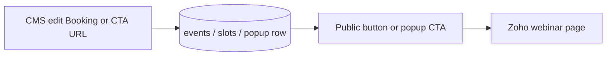

# Site plan Batch 03 — Popups & Zoho / webinar links

**Series:** [`SITE-BACKEND-PLAN.md`](./SITE-BACKEND-PLAN.md)  
**After:** Admin · CMS · Student Ops (LOCKED)  
**Before:** Security spine (05)  
**Status:** **LOCKED for series** — owner READY 03 · planning only · deepen with named `GO AHEAD POP-…` / `GO AHEAD popups` later · **no product code from this lock alone**  
**Date locked:** 2026-09-21  
**Skill:** `.cursor/skills/pgs-popups/SKILL.md`  
**Living map:** [`PGS-POPUPS.md`](./PGS-POPUPS.md)  
**CMS home for editors:** [`SITE-PLAN-02-CMS.md`](./SITE-PLAN-02-CMS.md) · gate **CMS-P**  
**Master Track C:** `.cursor/skills/pgs-master-workflow/SKILL.md`

---

## WHAT (owner picture)

**Popups and their links live in CMS.** Staff paste a Zoho webinar / booking URL into the right field. The public site does **not** invent a second booking database — Zoho (or Meet) stays outside PGS; PGS stores the **URL** and opens it from a button, a popup CTA, or an event/UnivMeet card.

```text
CMS (same staff login)
  ├── Event / webinar row     → booking_url = Zoho link     (EXISTS today)
  ├── UnivMeet meeting slot   → booking_url = Zoho link     (EXISTS today)
  └── Popup module (later)    → CTA url / webinar url       (MISSING CMS)
         │
         ▼
Public page button / card / popup CTA
         │
         ▼
Opens Zoho (external) — register / join happens on Zoho
```

**Hard locks**

- One popup **system** (ADAPT SoftLock / BumpPremium / marketing popups) — not a new SaaS popup product.  
- Booking **outside** PGS — no PGS “webinar registration table” unless owner later asks.  
- URLs must be `https://` (already validated on catalog `booking_url`).  
- Build only with `GO AHEAD popups` / `GO AHEAD POP-n` + owner Figma desktop+mob for popup chrome.

---

## How staff update Zoho / webinar links (LOCKED)

| Option | Verdict |
|---|---|
| Paste URL in code / `content.ts` | **Temp only** while CTA is `data-popup-deferred` — not the product |
| **CMS table + edit form** | **YES — forever path** |
| Framer-style visual page builder | **REJECT** — layout stays Figma/code; CMS = typed fields only |

**Today:** `/admin/catalog` → Events / Meeting slots → field **Booking URL** (collection table + form).  
**Later popups:** same pattern — Popups list in CMS → **CTA URL** field (no Framer).

---

Three patterns. Pick by **where the user clicks**.

### Pattern A — Button → Zoho (no popup)

```text
Page button (e.g. “Book webinar”)
  → href = https://zoho…/webinar/…   (from CMS field on that page/event)
  → new tab / same tab (product choice)
```

**When:** Simple CTA, no form in a PGS modal.  
**CMS today:** Event `booking_url` · meeting slot `booking_url` · typed page slot CTA URL where approved.  
**ELI5:** You paste the Zoho link in Admin → the purple button just opens that link.

### Pattern B — Button → Popup → Zoho (most marketing / SoftLock cases)

```text
Page button (data-popup-deferred="…")
  → opens PGS popup (Figma chrome · copy · fields)
  → popup primary CTA button
       → href = Zoho webinar / booking URL from CMS popup record
  → user leaves to Zoho to finish
```

```text
┌─ Public page ─────────────────────┐
│  [ Book a call ]  ──click──┐      │
└────────────────────────────│──────┘
                             ▼
┌─ Popup (CMS-edited) ──────────────┐
│  Title / body / image             │
│  [ Register on Zoho ] ──► Zoho URL│
│  [ Close ]                        │
└───────────────────────────────────┘
```

**When:** SoftLock, Premium bump, “Call us”, Help Hub book, hero CTAs marked `data-popup-deferred`.  
**CMS later:** Popup module = copy + **CTA URL** (Zoho) + which trigger key opens it.  
**ELI5:** Button opens our pretty popup; the big button *inside* the popup is the Zoho link you pasted in CMS.

### Pattern C — Event / UnivMeet card → Zoho

```text
Purple Events card / Upcoming / UnivMeet slot
  → “Register” / “Join” uses events.booking_url
     or university_meeting_slots.booking_url
  → Zoho (or Meet) URL from catalog row
```

**When:** Scheduled webinars and meeting slots.  
**CMS today:** `/admin/catalog` → Events · Content → Meeting slots — field **Booking URL**.  
**ELI5:** Edit the event → paste Zoho webinar link in Booking URL → card button uses it.

### Pattern D — Deep Zoho API (NOT for “paste webinar link”)

```text
Zoho OAuth · webhooks · sync leads/registrants into PGS
```

**Status:** Track C later · **PARTIAL** leads UI · **do not** mix into “paste URL on button/popup.”  
Owner must pick Zoho vs Google vs defer before that gate.

---

## Visual — where links are edited (CMS)

```text
┌─ CMS /admin ──────────────────────────────────────────────┐
│  Catalog → Events                                         │
│    Title · dates · media · [ Booking URL = Zoho ]         │
│                                                           │
│  Content → Meeting slots (UnivMeet)                       │
│    Label · time · [ Booking URL = Zoho ]                  │
│                                                           │
│  Popups (MISSING — CMS-P / POP gates)                     │
│    Trigger key · copy · media · [ CTA URL = Zoho ]        │
│    Map: which page button opens this popup                │
└───────────────────────────────────────────────────────────┘
```

---

## Connection map

```text
Staff CMS edit
  → sanitize https URL (reject javascript:)
  → store on row (events / meeting_slots / future popup_modules)
  → publish
  → Public FE reads published URL only
  → <a href={url} rel="noopener" target="_blank"> or popup CTA
  → Zoho hosts registration (outside PGS)
```



**Deferred triggers already in FE (visual only today):**

| Trigger key (examples) | Surface |
|---|---|
| `premium-*-call` | Premium heroes |
| `explore-countries-call` | Explore Countries |
| `scholarship-book` | Scholarship |
| `eligibility` | Finance |
| Help Hub book | Student feed (comment: popup/Zoho deferred) |

These `data-popup-deferred="…"` markers are the **hook** for Pattern B once popup CMS + SoftLock exist.

---

## Honesty map

| Piece | Status |
|---|---|
| `events.booking_url` in CMS + public catalog | **EXISTS** |
| `university_meeting_slots.booking_url` + UnivMeet | **EXISTS** |
| HTTPS URL sanitization on admin values | **EXISTS** |
| Popup CMS module (copy + CTA URL + trigger map) | **MISSING** |
| SoftLock / BumpPremium runtime | **DEFERRED** Track C |
| Hero / Help Hub CTAs | **DEFERRED** (`data-popup-deferred`) |
| Zoho OAuth / registrant sync | **DEFERRED** · not needed for paste-URL |

---

## Reference Bank

| Need | Bank / source | Notes |
|---|---|---|
| Popup **content** editing | **RB-09 / RB-10** (CMS) | Typed modules · draft/publish — same as other CMS |
| Popup **UX / triggers** | SoftLock · BumpPremium · V6 Popup Figma | **ADAPT** — no second system |
| Zoho paste-URL | Existing `booking_url` pattern | **ADOPT** |
| Zoho deep API | Track C · owner pick | Not bank install |
| Mature modal a11y | Radix/shadcn Dialog (locked stack) | Focus · Escape · name |

`REFERENCE BANK GAP` for a dedicated “popup product” row — we **do not** invent one. SoftLock + CMS + Figma are authority.

**REJECT:** Embed Zoho iframe as the whole page · store Zoho passwords in CMS · free-HTML popup builder · javascript: URLs · second popup framework beside SoftLock.

---

## Game plan (gates)

```text
POP-0  Plan QC (this doc) + owner Figma when ready
POP-1  Inventory all data-popup-deferred + Hostinger SoftLock triggers
POP-2  CMS popup module contract (fields · CTA URL · trigger key · publish)
POP-3  SoftLock / marketing popup runtime (one system) + wire 1–2 triggers
POP-4  Wire remaining deferred CTAs → popup → Zoho CTA URL
POP-5  Event/slot booking_url QC (already EXISTS — polish only)
POP-Z  Zoho OAuth / sync (optional later — not paste-URL)
```

Aligns with CMS gate **CMS-P**. Prefer `GO AHEAD POP-n` after Figma.

---

## Owner decisions

1. **Default Pattern B CTA:** always open Zoho in new tab?  
2. **Popup types v1:** SoftLock · Premium bump · Book call · Marketing — which first?  
3. **Figma:** share V6 Popup desktop+mob before POP-2/3 build?  
4. **Deep Zoho API:** park until after paste-URL popups work?  
5. Any trigger that must be **Pattern A** (button straight to Zoho, no popup)?

---

## How to continue

| You say | What happens |
|---|---|
| Picture change | Re-propose · re-lock if contract moves |
| `GO AHEAD POP-n` / `GO AHEAD popups` | One build gate only (plan lock ≠ build) |
| Next series | Draft **Batch 05 — Security** (or 04 if still needed) |

Companions: `pgs-popups` · `pgs-cms` · `pgs-master-workflow` Track C · `pgs-propose-before-code`.
