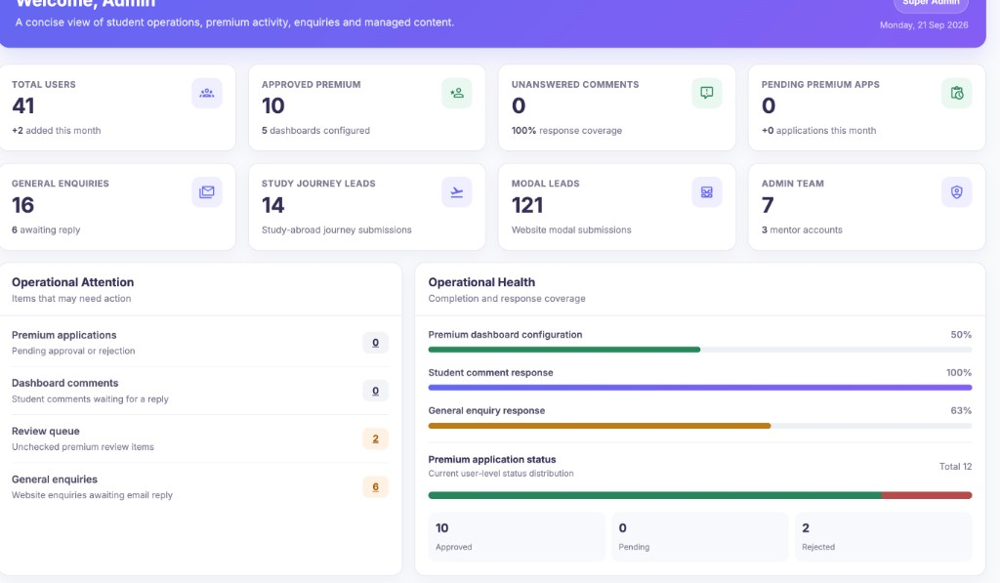
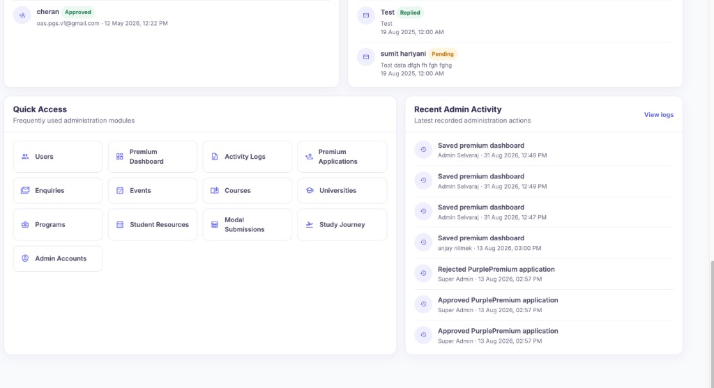
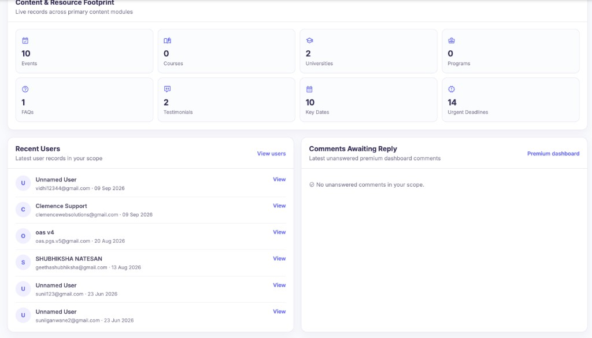
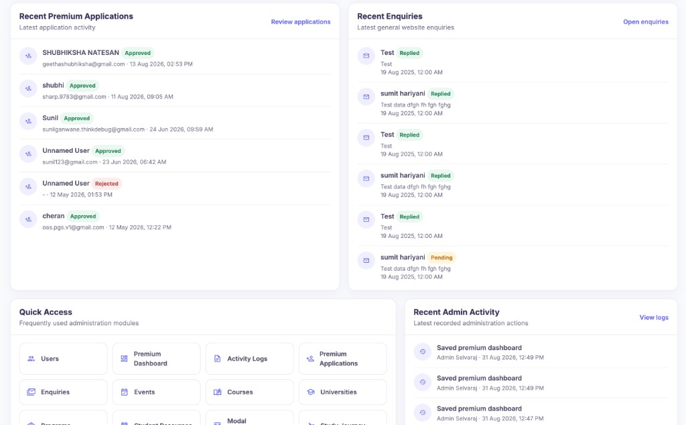
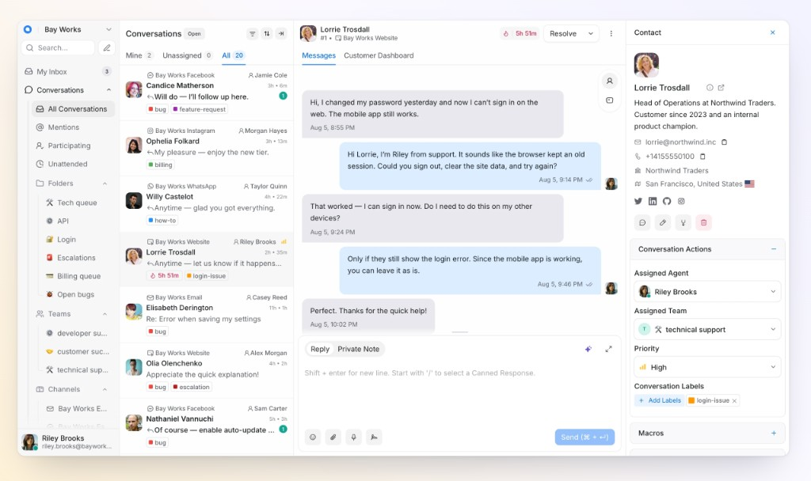
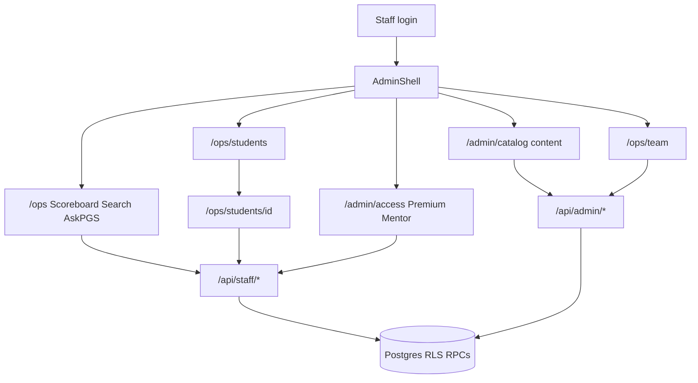

# Admin / Ops — full inventory (owner QC bible)

**Series:** [`SITE-BACKEND-PLAN.md`](./SITE-BACKEND-PLAN.md)  
**Companions:** [`SITE-PLAN-01-ADMIN-ROLES.md`](./SITE-PLAN-01-ADMIN-ROLES.md) · [`SITE-PLAN-01-EXECUTION-VISUAL.md`](./SITE-PLAN-01-EXECUTION-VISUAL.md) · [`SITE-PLAN-REFERENCES-AND-WIRING.md`](./SITE-PLAN-REFERENCES-AND-WIRING.md)  
**Status:** DRAFT for owner QC — planning only · **no product code**  
**Date:** 2026-09-21 · Hostinger screenshot map added same day  

**How to QC:** read this doc → compare Hostinger refs below → click live `/ops` and `/admin/...` → reply gaps → `READY ADMIN-INVENTORY` → next we draft **CMS**, then **Student Operations**.

**Not in this pass:** migrations, lag fixes, redesign, face cards, CMS depth, Student Ops depth.

---

## 0. What Admin is for (owner product picture)

Admin / Operations is the **staff cockpit**: roles, whole-PGS health overview, Premium grant/revoke, targets, search (students / staff / mentors), activity logs, period joins (month/year), event/course/content counts, enquiries — so you see **how well PGS is working** without nitpicking every student page.

```text
ADMIN / OPS HOME  =  “How is PGS doing?” + jump to work
        │
        ├── Roles / team
        ├── Overview KPIs (users, premium, leads, comments, team)
        ├── Attention queue (what needs action)
        ├── Search → students · admins · mentors · catalog
        ├── Premium grant / revoke  (+ mentor assign)
        ├── Targets / work
        ├── Activity this month / year
        └── Deep links → CMS modules · Student Ops (later batches)
```

| Next batch | Owns |
|---|---|
| **This doc** | Admin / Ops home + shell + access + registry entry + scoreboard |
| **CMS** (Batch 02) | Catalog + content + media editing depth |
| **Student Operations** (after CMS) | Per-student workspace (comments, loopboard, docs, …) |

---

## 0b. Hostinger admin home (evidence) — ADOPT / ADAPT / REJECT

Screenshots saved under [`docs/site-plan-refs/`](./site-plan-refs/).

### Welcome KPIs + attention + health



| Hostinger block | Intent | V3 today | Verdict |
|---|---|---|---|
| Welcome + role + date | Staff context | Ops shell + actor menu | **ADOPT** |
| Total users · +this month | Growth overview | Scoreboard total / joined_month | **ADOPT** (metric contracts) |
| Approved Premium · dashboards configured | Premium health | Scoreboard premium + workspace | **ADAPT** — truth = `premium_entitlement`, not applications |
| Unanswered comments · response % | Mentorship health | Scoreboard / Ask PGS / workspace comments | **ADAPT** — one `workspace_comments` truth |
| Pending Premium apps | Application queue | Legacy PurplePremium applications | **REJECT as Premium truth** — use grant/revoke on `/admin/access` |
| General enquiries · Study Journey · Modal leads | Lead volume | `/admin/leads` | **ADOPT** |
| Admin team · mentor count | People & Access | `/ops/team` | **ADOPT** |
| Items that may need action | Attention queue | Targets + scoreboard attention + Ask PGS | **ADAPT** into Ops home (not invent second queue product) |
| Operational health bars | Coverage % | Partly in analytics / Ask PGS | **ADAPT** — only with real formulas (RB-03) |
| Premium app status bar (Approved/Pending/Rejected) | Application funnel | — | **REJECT** as entitlement UI — replace with **active / revoked / never entitled** if needed |

### Quick Access + Recent Admin Activity



| Quick Access tile | Maps to V3 | Verdict |
|---|---|---|
| Users | `/ops/students` | **ADOPT** |
| Premium Dashboard | Student Ops / Premium workspace fields | **ADAPT** (per-student, not fake app queue) |
| Activity Logs | `/ops/activity` | **ADOPT** |
| Premium Applications | — | **REJECT** as product truth → `/admin/access` grant/revoke |
| Enquiries | `/admin/leads` | **ADOPT** |
| Events / Courses / Universities / Programs | `/admin/catalog/...` | **ADOPT** (CMS batch deepens) |
| Student Resources | content / media | **ADAPT** → CMS |
| Modal Submissions / Study Journey | `/admin/leads` types | **ADOPT** |
| Admin Accounts | `/ops/team` | **ADOPT** |
| Recent Admin Activity feed | Scoreboard activity + `/ops/activity` | **ADOPT** |

### Content footprint + recent users + comments awaiting



| Block | V3 | Verdict |
|---|---|---|
| Events/Courses/Universities/Programs/FAQs/Testimonials/Key Dates/Deadlines counts | Catalog + content module counts (CMS) | **ADOPT** as Ops overview widgets fed by catalog/content (CMS owns edit) |
| Recent Users | Registry “joined recently” | **ADOPT** |
| Comments awaiting reply | Unanswered `workspace_comments` | **ADOPT** intent · wire in Student Ops / scoreboard attention |

### Premium applications + enquiries lists



| Block | Verdict |
|---|---|
| Recent Premium Applications (Approved/Rejected) | **REJECT** as forever UI — history becomes **entitlement events** on `/admin/access` |
| Recent Enquiries | **ADOPT** → `/admin/leads` |

### Inbox-style reference (Chatwoot / Intercom feel — not Hostinger)



**ADOPT patterns:** searchable list · conversation thread · right-hand person profile · labels/priority.  
**REJECT:** turning PGS Ops into a generic multi-channel support desk. PGS comments stay **one student conversation domain** (RB-05).

---

## 0c. Shared login ≠ company data (hard lock)

You are right: **one staff Auth id does not mean every staff sees the whole company.**

```text
Same login door
  → staff_profiles + role assignment
  → permission keys (what operations allowed)
  → scope predicate (WHOSE rows)
       Admin/Super  → organization (when students.read + student_workspace.read_all)
       Mentor       → assigned_students only (mentor_assignments)
       Read-only    → narrow / restricted (often no org scoreboard dump)
  → RLS + RPC enforce again (not React hide)
```

**Today in V3 (EXISTS):**

| Control | How it works |
|---|---|
| Surface access | No `catalog.manage` → cannot edit CMS; no `premium.manage` → cannot grant Premium |
| Scoreboard scope | `resolveOperationsScoreboardScope` → `organization` \| `assigned_students` \| `restricted` ([`operations-authorization.ts`](../src/lib/operations-authorization.ts)) |
| Registry / Student Ops | Mentors only see assigned students |
| Team invite | `roles.manage` = Super only |

**NOT today (MISSING — your toggle vision):**

| Vision | Status |
|---|---|
| Per-widget / per-feature toggles (“this Admin sees Events count; that Mentor sees only Targets”) beyond role bundles | **MISSING** — today = coarse role → permission matrix, not a Super UI of checkboxes per dashboard card |
| Super configures “Mentor may see content footprint but not enquiries KPI” | **MISSING** — would be new permission keys or a feature-visibility table (Batch 05 / People & Access deepen — **propose later, don’t invent now**) |

**ADOPT intent:** least privilege + scope.  
**ADAPT later:** finer “feature visibility” toggles on People & Access (RB-02), still **server-enforced**.  
**REJECT:** trusting the client, or “shared password = shared data.”

---

## 0d. What’s missing on Admin overview (honest gap list)

Admin home should answer: **“What’s happening in PGS?”** Hostinger showed a richer cockpit than `/ops` alone. Map:

### Already on `/ops` (good spine)

- Student totals / premium / assigned / unassigned / awaiting mentor  
- Joined this month / year (org or my-students for mentors)  
- Attention card (e.g. premium awaiting mentor)  
- Mix / trend / activity peek / operate links  
- Header **Search** + **Ask PGS**  

### Missing or only PARTIAL vs your Hostinger overview

| Overview need | Hostinger had | V3 `/ops` today | Gap |
|---|---|---|---|
| Unanswered comments count + response % | Yes | Not as first-class KPI cards | **MISSING** on scoreboard (data can live in `workspace_comments`) |
| Enquiries awaiting reply | Yes | `/admin/leads` exists; not on home KPI row | **MISSING** home widget |
| Study Journey / Modal lead counts | Yes | Leads page | **MISSING** home widgets |
| Admin team / mentor headcount | Yes | `/ops/team` | **MISSING** home widget |
| Content footprint (events, courses, FAQs, deadlines, …) | Yes | Catalog/content exist | **MISSING** aggregate cards on `/ops` |
| Attention list (apps, comments, review queue, enquiries) | Yes | Partial attention (premium unassigned) | **PARTIAL** — expand attention queue |
| Operational health % bars | Yes | Analytics panel PARTIAL | **PARTIAL** — need real formulas |
| Quick Access grid | Yes | Search + operate links | **PARTIAL** — no Hostinger-style tile grid |
| Period filter (this week / month / year) as owner control | Implied | Month/year metrics exist; week + picker weak | **PARTIAL** |
| Event/course **join** counts (“how many students joined X”) | Owner ask | Catalog counts ≠ attendance/joins | **MISSING** contract — need real event/course engagement truth before fake KPIs |
| Per-role / per-person **feature visibility toggles** | Owner ask | Role permission bundles only | **MISSING** (see §0c) |
| Premium Applications queue as overview | Yes | Rejected as entitlement truth | **REJECT** — show entitlement health instead |

### What we will NOT put on Admin overview

- Invented % or sparklines without a metric contract (RB-03)  
- Full CMS editors (Batch **02**)  
- Full Student Ops panels (after CMS)  
- Company-wide numbers for mentors (scope must stay assigned)

---

## 1. Stack (locked)

| Layer | Choice |
|---|---|
| App | Next.js App Router · React · TypeScript · Vercel |
| Auth / DB | Supabase Auth · Postgres · RLS · RPCs |
| Ops UI | shadcn/ui · Lucide · TanStack Table (lists) · Recharts (scoreboard) |
| Forms | React Hook Form + Zod (CMS / catalog) |

Shared staff shell: [`src/app/admin/layout.tsx`](../src/app/admin/layout.tsx) + [`src/components/admin-shell.tsx`](../src/components/admin-shell.tsx).

---

## 2. Reference Bank (feel — don’t copy UI)

| Surface | Feel like | Bank | OSS study |
|---|---|---|---|
| Roles / Team | GitHub Orgs / Teams | **RB-02** | `supabase/supabase` |
| Scoreboard | HubSpot Reporting | **RB-03** | `PostHog/posthog` |
| Student registry | HubSpot CRM | **RB-01** | `twentyhq/twenty` |
| Comments / inbox | Intercom / Linear Inbox | **RB-05** / **RB-04** | `chatwoot/chatwoot` |
| Loopboard | Linear | **RB-06** | `makeplane/plane` |
| Review / alerts | Linear | **RB-07** | Plane |
| CMS catalog / pages | Contentful | **RB-09** / **RB-10** | `payloadcms/payload` |
| Documents QC | Google Drive | **RB-08** | `paperless-ngx/paperless-ngx` |
| Lag / traces (later) | Sentry | **RB-13** | `getsentry/sentry` |

**Live screenshots = your running V3** (`/ops`, `/admin/...`). Bank apps are external “feel” only — no pixel dump into the repo.

---

## 3. Two URL families (same staff cookie)

```text
ONE staff login  (/login?surface=operations)
        │
        ├── OPERATIONS  /ops/*     ← sidebar nav
        └── CMS / BACK-OFFICE
              /admin/catalog · content · access · media · leads · settings
              (same session; often via Search deep-link, not Ops sidebar)
```



| Alias | Goes to |
|---|---|
| `/cms` | `/admin/content/pages` |
| `/mentor` | `/ops/students` |
| `/mentor/access` | `/admin/access` |
| `/mentor/students/[id]` | `/ops/students/[id]` |
| Many `/admin/students` etc. | **308** → `/ops/...` |

---

## 4. Role × surface (quick)

| | Super | Admin | Mentor | Read-only |
|---|---|---|---|---|
| Scoreboard / Search / Ask PGS | org | org | scoped | narrow |
| Registry / Student Ops | global | global | assigned | peek |
| Premium grant / revoke | ✓ | ✓ | ✗ | ✗ |
| Team invite | ✓ (`roles.manage`) | ✗ | ✗ | ✗ |
| Catalog / CMS mutate | ✓ | ✓ | ✗ | ✗ |
| Activity | ✓ | ✓ | ✗ | ✗ |

Detail: [`SITE-PLAN-01-ADMIN-ROLES.md`](./SITE-PLAN-01-ADMIN-ROLES.md).

---

## 5. Screen inventory (everything Admin does today)

### A. Ops chrome (every `/ops` page)

```text
┌──────────┬─────────────────────────────────────────┐
│ OPS      │  [Ask PGS]  [Search…………]  [Bell] [You] │
│ Scoreboard│  …page body…                            │
│ Students │                                         │
│ Targets  │                                         │
│ Team     │                                         │
│ Notifs   │                                         │
│ Activity │                                         │
└──────────┴─────────────────────────────────────────┘
```

| Piece | What you see | FE | BE | Status |
|---|---|---|---|---|
| Nav | Scoreboard, Students, Targets, Team, Notifications, Activity | [`admin-shell.tsx`](../src/components/admin-shell.tsx) | Permission filter | **EXISTS** |
| Search | Cross-domain jump (students, catalog, pages, staff, work) | `OperationsStaffSearch` | `GET /api/staff/search` → RPC `staff_operations_search` | **EXISTS** |
| Ask PGS | “What needs attention?” facts + next step | `AskPgsPanel` | `POST /api/ai/ops` | **PARTIAL** if AI env off |
| Preview banner | View-as student / mentor | `StaffPreviewBanner` | `POST /api/staff/preview` + cookie + audit | **EXISTS** |

**Search domains:** `students` · `courses` · `events` · `programs` · `universities` · `pages` · `staff` · `work`.

---

### B. Scoreboard home — `/ops`

| Does | FE | BE / tables | Status |
|---|---|---|---|
| KPI overview (total, premium, assigned, …) | `OperationsScoreboardView` | RPC `staff_operations_scoreboard` | **EXISTS** |
| Mix / trend / activity / roster | panels + Recharts | `audit_events` snippet · assigned profiles | **EXISTS** |
| Analytics segment | `OperationsAnalyticsView` | RPC `staff_operations_analytics` (+ targets summary) | **PARTIAL** when scope `restricted` or RPC fails |

**Gate:** `overview.read` · scope org vs mentor-assigned ([`operations-authorization.ts`](../src/lib/operations-authorization.ts)).  
**Bank feel:** RB-03.

**Page:** [`src/app/admin/page.tsx`](../src/app/admin/page.tsx).

---

### C. Students registry — `/ops/students`

| Does | FE | BE | Status |
|---|---|---|---|
| Filter / search / saved views | Registry + filter bar + saved views | RPC `staff_student_registry_v2` · `staff_registry_saved_views` · `POST /api/admin/registry-views` | **EXISTS** |
| Assign / end mentor (inline) | `OperationsRegistryAssignmentActions` | `POST /api/staff/assignments` → `set_mentor_assignment` | **EXISTS** |
| Open student · premium entry | links | → `/ops/students/[id]` · `/admin/access` | **EXISTS** |

**Gate:** `overview.read` + registry read (`students.read` / `student_workspace.read` / `read_all`) · assign needs `mentor_assignments.manage`.  
**Bank feel:** RB-01.

**Page:** [`src/app/admin/students/page.tsx`](../src/app/admin/students/page.tsx).

---

### D. Premium grant / revoke + mentor — `/admin/access`

Owner product: grant / revoke / reactivate Premium and mentor assign on one access console.

```text
┌────────────────────────────────────────────┐
│  Premium & mentor access                   │
│  Student [____________]                    │
│  [ Grant Premium ] [ Revoke ] [ Reactivate]│
│  Mentor  [____________] [ Assign ] [ End ] │
│  History …                                 │
└────────────────────────────────────────────┘
```

| Does | FE | BE | Status |
|---|---|---|---|
| Grant / revoke / reactivate Premium | `StaffAccessControls` | `POST /api/staff/premium` → `set_premium_entitlement` · `premium_entitlement` + `premium_entitlement_events` | **EXISTS** |
| Assign / end mentor | same page | `POST /api/staff/assignments` → `set_mentor_assignment` · `mentor_assignments` | **EXISTS** |
| History lists | page | entitlement events · assignment history | **EXISTS** |

**Gate:** `premium.manage` · mentor preview redirected away.  
**ONE Premium truth:** `premium_entitlement` (not a staff role).  
**Page:** [`src/app/admin/access/page.tsx`](../src/app/admin/access/page.tsx).

---

### E. Student Operations — `/ops/students/[id]`

Same relational student truth as Premium student surfaces.

```text
┌──────────┬──────────────────────────────────────────────────┐
│ OPS      │  Student: …  · Premium? · Mentor: …              │
│ Students │  [CRM] [Guardians] [Loopboard] [Comments] …      │
│          │  Documents · Alerts · Reviews · Notes · Unis     │
└──────────┴──────────────────────────────────────────────────┘
```

| Module | What staff do | API → tables | Status | Bank |
|---|---|---|---|---|
| CRM identity / tags | Edit facts, tags | `POST .../crm` → CRM RPCs | **EXISTS** | RB-01 |
| Guardians | List / manage | `GET/POST .../guardians` | **EXISTS** | RB-14 provisional |
| Loopboard | Tasks / columns | `.../workspace/tasks` → `student_tasks`, `student_board_columns` | **EXISTS** | RB-06 |
| Comments | Thread with student | `.../workspace/comments` → `workspace_comments` | **EXISTS** | RB-05 |
| Alerts | Important alerts | `.../workspace/alerts` → `student_alerts` | **EXISTS** | RB-07 |
| Review queue | Pending reviews | `.../workspace/reviews` → `review_queue_items` | **EXISTS** | RB-07 |
| Counselor notes | Staff notes | `.../workspace/notes` → `counselor_notes` | **EXISTS** | — |
| Documents | Requirements + QC | `.../requirements` · `.../documents` → Phase 4D | **EXISTS** | RB-08 |
| Universities | Shortlist | `.../workspace/universities` → `student_university_selections` | **EXISTS** | — |
| Premium profile fields | Dashboard facts | `PATCH .../workspace/profile` → `premium_workspace_profiles` | **EXISTS** | — |
| View as Student | Read-only preview | `POST /api/staff/preview` | **EXISTS** | — |

**Workspace API:** `/api/staff/students/[studentId]/workspace/[resource]`  
Resources: `comments` · `tasks` · `alerts` · `reviews` · `notes` · `requirements` · `universities` · `documents` · `profile`.

**Gate:** `overview.read` + workspace read; mutations need manage / Premium actor rules.  
**Page:** [`src/app/admin/students/[studentId]/page.tsx`](../src/app/admin/students/[studentId]/page.tsx).

**Note:** Student **feed** comments UI may still be fixture — staff path uses `workspace_comments` (one conversation truth). Do not invent a second comments system.

---

### F. Team (People & Access) — `/ops/team`

| URL | Does | FE | BE | Status |
|---|---|---|---|---|
| `/ops/team` | Staff directory | `OperationsStaffDirectory` | RPC `staff_people_directory` | **EXISTS** |
| `/ops/team/invite` | Invite + role (**Super**) | `OperationsStaffInviteForm` | `POST /api/admin/staff` → `manage_staff_access` + Auth invite | **EXISTS** · resend **PARTIAL** |
| `/ops/team/[id]` | Permissions, history, targets, mentor preview | `OperationsStaffAccessDetail` | `staff_access_detail` · history · targets RPCs | **EXISTS** |

**Gate:** `staff.read` · invite / role change `roles.manage`.  
**Bank feel:** RB-02.

---

### G. Work / Targets — `/ops/work`

| Does | FE | BE | Status |
|---|---|---|---|
| Operational responsibility queue (not performance scoring) | Target summary / form / list | RPCs `staff_targets_*` · `POST/PATCH /api/staff/targets` | **EXISTS** |

**Gate:** `overview.read` · create/manage via `staff_targets.manage` / `manage_all`.  
**Bank feel:** RB-07.

---

### H. Notifications — `/ops/notifications`

| Does | FE | BE | Status |
|---|---|---|---|
| Staff inbox (read / archive) | `OperationsNotificationInbox` | RPC `staff_notifications_list` · `PATCH /api/staff/notifications/[id]` → `manage_staff_notification` | **EXISTS** |

**Gate:** `overview.read`.  
**Bank feel:** RB-04.  
Unread count also loads in shell via `staff_notifications_unread_count`.

---

### I. Activity — `/ops/activity`

| Does | FE | BE | Status |
|---|---|---|---|
| Human-readable audit feed | `OperationsActivityList` | RPC `staff_operations_activity` → `audit_events` | **EXISTS** |

**Gate:** `audit.read` · hidden from mentor-preview nav.  
**Not** the same as product notifications.

---

### J. CMS Catalog — `/admin/catalog`

**Not in Ops sidebar** — open via URL or Search.

| Entity key | Table / role | Status |
|---|---|---|
| `countries` | Lookup / reference | **EXISTS** |
| `universities` | Canonical universities | **EXISTS** |
| `programs` | CV-ready programs | **EXISTS** |
| `course_categories` / `courses` | Courses | **EXISTS** |
| `event_categories` / `events` | Sessions / webinars | **EXISTS** |
| `facilitators` | Event facilitators | **EXISTS** |
| `tags` | `catalog_tags` shared vocabulary | **EXISTS** |
| `facets` / `filter_options` | Filter system | **EXISTS** |

| Does | FE | BE | Status |
|---|---|---|---|
| Hub | catalog home | `catalog.read` | **EXISTS** |
| Entity CRUD | `AdminCrudManager` | `/api/admin/catalog/[entity]` | **EXISTS** |
| Drafts / publish | draft UI | `/api/admin/catalog/[entity]/drafts` · `catalog.publish` | **EXISTS** |
| Tag / filter links | relationships | `/api/admin/catalog/tag-links` · `filter-links` | **EXISTS** |
| Preview | draft preview | `/api/admin/catalog/preview` | **EXISTS** |

**Gate:** `catalog.read` / `.manage` / `.publish`.  
**Bank feel:** RB-09 / RB-10.  
**Registry:** [`src/lib/admin-registry.ts`](../src/lib/admin-registry.ts).

---

### K. CMS Content — `/admin/content`

| Area | URL | Does | BE | Status |
|---|---|---|---|---|
| Hub | `/admin/content` | Entry | `content.read` | **EXISTS** |
| Pages | `/admin/content/pages` · `/[slug]` | Typed page slots · draft/publish · Draft Mode | `cms_pages` · revisions · `/api/admin/cms` · preview | **EXISTS** |
| Modules | `/admin/content/modules/[module]` | Structured content CRUD | `/api/admin/content/[module]` | **EXISTS** |

**Example modules:** `article_categories`, `articles`, `highlights`, `faqs`, `testimonials`, `weekly_wall`, `key_dates`, `deadlines`, `facts`, `stats`, `people`, `finance_partner_logos`, `notices`, `legal`, `social`, `meeting_slots`, `premium_settings` (and others in registry).

**Bank feel:** RB-09 / RB-10 / RB-11 (Lexical only where rich text required — never page builder).

---

### L. Media · Leads · Settings · Profile

| URL | Does | FE | BE | Status |
|---|---|---|---|---|
| `/admin/media` | Marketing / CMS assets (not student docs) | `AdminMediaManager` | `media_assets` + Storage · `/api/admin/media` | **EXISTS** |
| `/admin/leads` | Enquiries / journeys / deadline subs triage | `AdminLeadTable` | lead tables · `/api/admin/leads/[type]` | **EXISTS** · Zoho **PARTIAL** |
| `/admin/settings` | Non-secret site JSON | `AdminSettingsManager` | `site_settings` · `/api/admin/settings` | **EXISTS** |
| `/admin/profile` | Display name | profile form | `PATCH /api/admin/profile` → `update_staff_display_name` | **EXISTS** · weak nav |

---

## 6. API map (staff + admin)

### `/api/staff/*`

| Route | Methods | Typical permission | Backend |
|---|---|---|---|
| `/api/staff/premium` | POST | `premium.manage` | `set_premium_entitlement` |
| `/api/staff/assignments` | POST | `mentor_assignments.manage` | `set_mentor_assignment` |
| `/api/staff/search` | GET | `overview.read` | `staff_operations_search` |
| `/api/staff/preview` | POST | preview permission | cookie + audit |
| `/api/staff/targets` | POST, PATCH | `staff_targets.*` | target RPCs |
| `/api/staff/notifications/[id]` | PATCH | `overview.read` | `manage_staff_notification` |
| `/api/staff/students/[id]/crm` | POST | workspace / RPC auth | CRM RPCs |
| `/api/staff/students/[id]/guardians` | GET, POST | read / `student_workspace.manage_all` | guardian server |
| `/api/staff/students/[id]/workspace/[resource]` | POST, PATCH, DELETE | Premium actor manage | workspace tables |

### `/api/admin/*`

| Route | Methods | Typical permission | Backend |
|---|---|---|---|
| `/api/admin/staff` | POST | `roles.manage` | `manage_staff_access` · Auth invite |
| `/api/admin/registry-views` | POST | registry | `staff_registry_saved_views` |
| `/api/admin/catalog/*` | CRUD · drafts · preview · links | `catalog.*` | catalog tables |
| `/api/admin/cms` · `cms/preview` | POST · GET | `cms.*` | pages / revisions / Draft Mode |
| `/api/admin/content/[module]` | POST, PATCH, DELETE | `content.*` | content tables |
| `/api/admin/media` | POST, DELETE | `media.manage` | assets + Storage |
| `/api/admin/leads/[type]` | PATCH, POST | `leads.manage` | lead tables |
| `/api/admin/settings` | POST | `settings.manage` | `site_settings` |
| `/api/admin/profile` | PATCH | `overview.read` | `update_staff_display_name` |
| `/api/admin/preview/exit` | POST | active staff | clear draft cookies |

Plus Ask PGS: `POST /api/ai/ops` (`overview.read`).

---

## 7. FE → BE connection pattern (every module)

```text
Staff UI (Ops shell or /admin page)
  → requireStaffPermission / getStaffContext
  → fetch /api/staff/* or /api/admin/*
  → server checks permission again
  → Supabase RPC or table write under RLS
  → private.has_staff_permission + scope (mentor_assignments when needed)
  → audit_events / notifications where wired
```

**Never:** trust role name alone · fetch-all-then-hide in React · separate `ops_users` / `cms_users`.

---

## 8. PARTIAL / gaps (honest)

| Gap | Note |
|---|---|
| Ask PGS | 503 / empty when AI env not configured |
| Scoreboard analytics | Hidden when scope `restricted` or RPC fails |
| Invite resend | Deferred message in API |
| Zoho / lead provider sync | Future outbox — triage UI exists |
| CMS / catalog / media / settings / access | **Not** in Ops sidebar — URL or Search (Hostinger had Quick Access grid — **ADAPT** later as operate links, not rebuild Hostinger chrome) |
| `/admin/profile` | Weak / missing shell nav link |
| Student feed comments UI | May still be fixture; staff uses `workspace_comments` |
| Hostinger “Premium Applications” queue | **REJECT** as truth — grant/revoke on `/admin/access` |
| Content footprint widgets on `/ops` | Intent **ADOPT**; counts may need CMS/catalog aggregates (Batch 02 + scoreboard) |
| Lag | Known feel; measure later (RB-13) — **not** fixed in this doc |
| Face / template pickers | Parked ([`CATALOG-B-STAR.md`](./CATALOG-B-STAR.md)) |

---

## 9. Owner capability checklist (Admin page — your words)

| You said Admin should… | Where in V3 / plan | Status |
|---|---|---|
| Roles (Super / Admin / Mentor / Read-only) | `/ops/team` · Batch 01 | **EXISTS** |
| Overview of how PGS is working | `/ops` scoreboard + Ask PGS · Hostinger KPI map §0b | **EXISTS** / deepen metrics later |
| Grant / revoke Premium | `/admin/access` | **EXISTS** |
| Fix targets | `/ops/work` | **EXISTS** |
| What happened this month / year | Scoreboard join trend · `/ops/activity` | **EXISTS** (period filters may deepen) |
| How many joined events / courses / content footprint | Hostinger content cards · catalog counts | **ADAPT** — CMS supplies truth; Ops shows aggregates |
| Search students, admins, mentors | Header Search | **EXISTS** |
| Activity log | `/ops/activity` + scoreboard activity | **EXISTS** |
| See courses / events / programs / universities | Search → `/admin/catalog/*` | **EXISTS** (CMS batch for edit depth) |
| Enquiries / modal / study journey | `/admin/leads` | **EXISTS** |
| Comments needing reply | Hostinger “awaiting reply” | **ADAPT** into attention + Student Ops |
| Shared login but not company-wide data | Scope + permissions | **EXISTS** spine · finer toggles **MISSING** (§0c) |
| Toggle which Admin/Mentor sees which overview feature | People & Access deepen | **MISSING** — propose after READY, not invent now |

---

## 10. Owner QC checklist (live click)

| # | Click | Pass if |
|---|---|---|
| 1 | `/login?surface=operations` → `/ops` | Scoreboard + Search + Ask PGS visible (if granted) |
| 2 | Compare §0b Hostinger KPI list to `/ops` | Same *intent* (health overview), not pixel clone |
| 3 | Search a student / course / staff | Groups appear; deep-link works |
| 4 | `/ops/students` | Registry loads |
| 5 | `/admin/access` | Grant / revoke / mentor (Admin+) — **not** a PurplePremium application queue |
| 6 | `/ops/team` · invite (Super) | Directory; invite Super-only |
| 7 | `/ops/work` · notifications · activity | Loads under correct perms |
| 8 | `/admin/catalog/events` · `/admin/leads` | Same session as Ops |
| 9 | Mentor account | Scoped overview only — **no** org-wide company dump; no Premium grant; no Team invite |
| 10 | §0d gap list | Agree which overview widgets are P0 for a later build gate |
| 11 | Feature toggles | Confirm: keep role bundles for now, or require per-widget toggles before overview rebuild |

---

## 11. After READY — series order (locked)

```text
READY ADMIN-INVENTORY
  → Batch 02  SITE-PLAN-02-CMS.md          (catalog · pages · modules · media)
  → then      Student Operations plan      (per-student workspace depth)
  → then      Popups / Security as in SITE-BACKEND-PLAN
```

Build only with named `GO AHEAD` gates. No Admin redesign from Hostinger screenshots until you approve a visual gate.