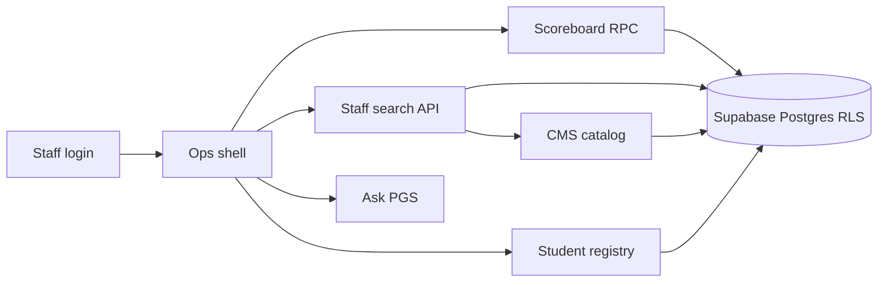

# Site plan — Reference inspiration + how V3 is wired (owner teach)

**Series:** [`SITE-BACKEND-PLAN.md`](./SITE-BACKEND-PLAN.md)  
**Status:** DRAFT — planning / learning only · no rebuild yet  
**Date:** 2026-09-21  

Owner ask: famous repos to study · V3 works but feels **super laggy** · hard to see **how things are wired**.

**Rule:** We only study the **PGS Reference Bank** (owner-locked). We do **not** randomly pick GitHub toys or replace PGS with HubSpot/Linear clones.

Full bank: `.cursor/rules/pgs-v3-reference-bank.mdc`

---

## 1. Famous apps + OSS — what to read for which job

### For Batch 01 (roles) — now

| Bank | Mature app (feel) | OSS repo (study patterns) | Steal for PGS | Do **not** |
|---|---|---|---|---|
| **RB-02 ACCESS** | GitHub Orgs / Teams | [`supabase/supabase`](https://github.com/supabase/supabase) | Auth + RLS · role vs permission · grant/revoke | New login products; dump their UI into PGS |

### For later batches (same series)

| Batch | Bank | Mature app | OSS (study) | PGS use |
|---|---|---|---|---|
| **02 CMS** | RB-09 · RB-10 | Contentful | [`payloadcms/payload`](https://github.com/payloadcms/payload) | Catalog/pages model · draft/publish · **not** page builder |
| **03 Popups** | (no bank row yet — `REFERENCE BANK GAP` until owner locks) | SoftLock / existing PGS popups first | — | Map triggers before inventing |
| **04 Ops** | RB-01 · RB-03 · RB-07 | HubSpot · Linear | [`twentyhq/twenty`](https://github.com/twentyhq/twenty) · [`makeplane/plane`](https://github.com/makeplane/plane) | Registry · scoreboard · queues |
| **04 Comments** | RB-05 | Intercom | [`chatwoot/chatwoot`](https://github.com/chatwoot/chatwoot) | One conversation thread |
| **04 Loopboard** | RB-06 | Linear | Plane | Kanban one board truth |
| **04 Notifs** | RB-04 | Linear Inbox | Chatwoot | Recipient inbox |
| **05 Security + lag** | RB-13 · RB-02 | Sentry | [`getsentry/sentry`](https://github.com/getsentry/sentry) | Traces · errors · **measure lag before “rewrite”** |
| **Search / scoreboard depth** | RB-03 · RB-12 | HubSpot Reporting · PostHog | [`PostHog/posthog`](https://github.com/PostHog/posthog) | Real metrics · search adapters |
| **Docs** | RB-08 | Google Drive | [`paperless-ngx/paperless-ngx`](https://github.com/paperless-ngx/paperless-ngx) | Review UX — **not** new storage architecture |
| **Ask PGS / AI** | RB-15 | locked later | locked later | **Do not pick an AI stack** until core data stable |

### Stack we already locked (do not replace for “famous”)

Next.js App Router · React · TypeScript · Supabase · Vercel · shadcn (Ops) · TanStack Table · Recharts · RHF+Zod · Playwright.

Inspiration = **patterns**. Build = **our stack + our product**.

---

## 2. How Ops is wired today (ELI5 map)

This is the “I don’t know how things are connected” picture for **admin / Operations**.

```text
YOU (browser)
  │
  ├─ /login?surface=operations
  │     → POST /api/auth/login  → Supabase Auth cookie
  │
  ├─ /ops  (Scoreboard home)
  │     → admin layout: must be staff (getStaffContext)
  │     → loadOperationsScoreboard()
  │           → RPC staff_operations_scoreboard  (Postgres)
  │           → + activity / roster slices
  │     → UI: KPI cards · charts · operate links
  │
  ├─ Header Search
  │     → GET /api/staff/search?q=…
  │           → searchOperations() adapters
  │           → students | courses | events | programs
  │             | universities | pages | staff | work
  │           → each adapter respects RLS + your permissions
  │     → click result → /ops/students/… OR /admin/catalog/…
  │
  ├─ Ask PGS
  │     → AI panel over allowlisted Ops tools/search
  │     → facts + summary + next step (permission-shaped)
  │
  ├─ /ops/students → registry RPC → Student Operations page
  │     → workspace loaders → same tables student Premium uses
  │
  └─ /admin/catalog · /admin/content
        → same staff cookie
        → catalog.manage / cms.manage / publish gates
```



**One sentence:** Same staff cookie opens Ops chrome; Scoreboard and Search are **server RPCs/APIs** over Postgres with **RLS**; CMS is other URLs, same cookie, different permission keys.

Deeper role detail: [`SITE-PLAN-01-ADMIN-ROLES.md`](./SITE-PLAN-01-ADMIN-ROLES.md) · visual screens: [`SITE-PLAN-01-EXECUTION-VISUAL.md`](./SITE-PLAN-01-EXECUTION-VISUAL.md)

---

## 3. Why it can feel “super laggy” (honesty — not a rewrite plan yet)

Existing audit already warned: measure before architecture surgery.  
Ref: [`docs/pgs-v3-audit/09-performance-baseline-plan.md`](./pgs-v3-audit/09-performance-baseline-plan.md)

| Likely area | What happens | Study / fix direction later |
|---|---|---|
| **Scoreboard home** | One page loads RPC + activity + roster + charts | RB-03 · snapshot vs live · fewer round-trips |
| **Staff search** | Many domain adapters per keystroke | Postgres-first search model (`12-scoreboard-search-analytics-model.md`) · debounce/cache |
| **Ask PGS** | Extra AI + tool calls on top of Ops | RB-15 parked · don’t expand until core fast |
| **Student Operations** | `loadPremiumWorkspace`-style aggregates | Audit note: parallel fetch can still **over-fetch** all domains |
| **CMS lists** | Catalog tables without tight indexes/pagination | RB-01 TanStack patterns · server pagination |
| **Unknown** | Network region, cold start, huge fixtures | **RB-13** Sentry/OTel — prove with traces |

**Owner lock for lag:**

```text
1. Finish site-plan batches (roles → CMS → popups → Ops → security) so we know WHAT
2. Then a LAG-BASELINE gate: measure /ops cold+warm (RB-13)
3. Then ONE fix gate at a time (e.g. scoreboard query only)
```

Do **not** “rebuild Ops like Twenty” to chase speed. Prove the bottleneck first.

---

## 4. How we will “read famous repos” without getting lost

Per module (when that batch is READY):

```text
1. Open only that Bank row’s mature app (click around 15 min)
2. Open only that OSS repo — architecture / data model / one feature folder
3. Write 6 lines: APP LESSONS · OSS LESSONS · FRAMEWORK · ADOPT · ADAPT · REJECT
4. Map onto existing V3 paths (never dump their codebase into pgs-v3)
```

Example for roles (Batch 01):

| | |
|---|---|
| **APP** | GitHub: invite member → pick role → repo access follows |
| **OSS** | Supabase: Auth user ≠ permission; RLS policies on tables |
| **ADOPT** | One identity · permission checks server+DB |
| **ADAPT** | Onto `staff_*` + `/ops/team` |
| **REJECT** | Separate CMS login tables |

---

## 5. Suggested learning order (matches site plan)

| Week-ish | Read / click | Outcome |
|---|---|---|
| Now | This doc + Batch 01 visual | You see Ops wiring |
| After READY 01 | RB-02 Supabase Auth/RLS docs (not whole monorepo) | Roles confidence |
| Batch 02 | Contentful concepts + Payload “collections” docs | CMS mental model |
| Batch 04 | Twenty CRM list/filters (feel) + Plane board (feel) | Ops depth without copy |
| Lag gate | Performance baseline doc + one Sentry/trace pass | Know *why* laggy |

---

## 6. Owner checklist

- [ ] Comfortable that inspiration = **Bank only**, not random repos  
- [ ] Wiring map above matches what you experience on `/ops`  
- [ ] Agree: **no lag rewrite** until baseline gate after site-plan rough idea  
- [ ] Say which surface feels slowest: Scoreboard · Search · Ask PGS · Student page · CMS list  

---

## Next

Continue **READY 01** → Batch 02 CMS storyboard, **or** ask for a one-page **wiring map of Student Operations** (comments/docs/loopboard) the same way — still no code.
