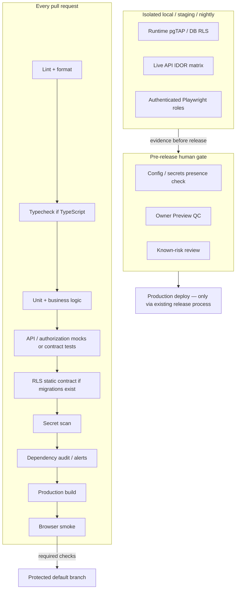

# Quality Gate — Architecture

Reusable pipeline and layering for Projects of 24. Application-specific actors live in [role-permission-matrix.md](./role-permission-matrix.md).

---

## Design principles

1. **Smallest effective toolset** — prefer tools already in the app repo.
2. **Fail closed on security** — critical auth/RLS/API negatives must be able to block merge when they exist in CI.
3. **Environment honesty** — local ≠ CI ≠ staging ≠ production; document which tests run where.
4. **No second product truth** — quality docs describe verification; they do not redefine RBAC or domain contracts.
5. **Reusable core, app annex** — helpers and CI patterns travel; role matrices do not.

---

## Pipeline (target shape)



**Phase 0 note (PGS):** PR stages largely exist today. Runtime pgTAP, live IDOR matrix, and authenticated Playwright promotion are roadmap items — see [README.md](./README.md#prioritized-implementation-roadmap-postphase-0).

---

## Environments

| Environment | Purpose | Allowed tests | Forbidden |
|---|---|---|---|
| **Local development** | Fast feedback | Unit, lint, typecheck, static RLS, secret scan, optional local Supabase pgTAP, optional Playwright against local app | Production credentials; destructive prod DB |
| **CI (GitHub Actions)** | Merge gate | Lint, types, unit, static RLS, secret scan, dependency audit, build, browser smoke (+ future approved jobs) | Production secrets; real payment charge; load tests that stress prod |
| **Staging / preview** | Product + security QC | Authenticated e2e, runtime RLS against non-prod DB, webhook mocks | Production data dumps without owner approval |
| **Production** | Serve users | Read-only health/synthetic checks if approved | Destructive security tests, load tests, pgTAP that mutates prod, real payment “tests” |

---

## Reusable core vs application-specific

```text
┌─────────────────────────────────────────────────────────┐
│ Reusable core (Projects of 24)                          │
│  - Auth negative patterns (401/403, expired session)    │
│  - Permission matrix template                           │
│  - API request helpers / IDOR checklist                 │
│  - Secret + dependency CI patterns                      │
│  - Test case metadata schema                            │
│  - Reporting / evidence conventions                     │
└─────────────────────────────────────────────────────────┘
                          │
          ┌───────────────┼───────────────┐
          ▼               ▼               ▼
     PGS V3          Sourcebyjay      AVForge / others
  student states     marketplace      script ownership
  staff permissions  buyer/seller     AI credits
  Premium / docs     org isolation    (as each app defines)
```

Rules:

- Core documents **how** to test authorization.
- Each app documents **who** may do **what**.
- Do not create a separate testing microservice unless an owner-approved requirement proves it necessary.

---

## Preferred tools (selection guide)

| Need | Prefer if already present | Add only with approval |
|---|---|---|
| Unit / business logic | Vitest / project equivalent | — |
| Browser / e2e | Playwright | — |
| Postgres RLS | pgTAP via Supabase CLI local | Hosted DB test runner |
| CI | GitHub Actions | — |
| PR review assist | CodeRabbit (advisory) | — |
| Secrets | CI Gitleaks + high-confidence repo scan | — |
| Dependencies | `pnpm`/`npm` audit + Dependabot | Commercial SCA later |
| Load | — | k6, separate from PR pipeline |

---

## Evidence model

A security control is:

| Claim | Allowed when |
|---|---|
| **Implemented** | Code/migration/test file exists |
| **CI-verified** | Runs on PR/main CI and job is intended to fail the workflow |
| **Runtime-verified** | Executed successfully against an isolated DB or staging with recorded evidence |
| **Not verified** | Only source review or static string checks |
| **Open risk** | Known gap; see [known-risks.md](./known-risks.md) |

Never equate “migration text contains policy name” with “RLS enforced for actor X against actor Y’s rows.”
